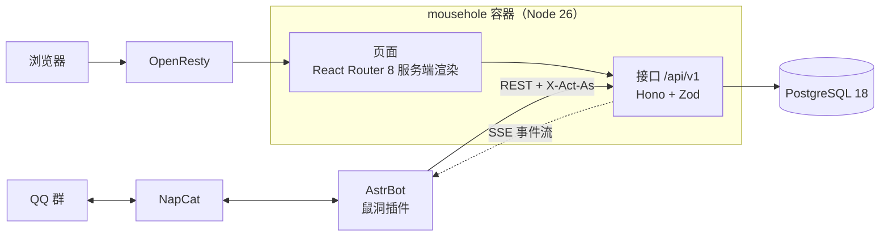

<div align="center">

<a href="https://bbs.mousebaoyan.cn"></a>

**四非计算机保研鼠群的论坛**

以 QQ 号作为论坛账号，通过 AstrBot 插件与 QQ 群相连。

[](https://github.com/mousebaoyan/mousehole/actions/workflows/ci.yml)
[](https://github.com/mousebaoyan/mousehole/tags)
[](LICENSE)
[](https://bbs.mousebaoyan.cn)

[访问鼠洞](https://bbs.mousebaoyan.cn) · [鼠群官网](https://mousebaoyan.cn/) · [AstrBot 插件](https://github.com/mousebaoyan/astrbot_plugin_mousehole) · [设计文档](docs/design.md)

</div>

## 简介

QQ 群里的保研问答和经验分享很有价值，但容易被后续消息淹没，难以检索，群被封禁时还会一并丢失。鼠洞将这些内容整理成论坛帖子，长期保存，便于检索和查阅。

- **沉淀群聊内容**：插件借助大模型识别群内有价值的提问和回答，收录为论坛的帖子和回复；成员也可以直接在论坛发帖。论坛内容不回传到群内，群里只推送标题、链接等提醒。
- **QQ 号即账号**：首次登录即完成注册，昵称、头像和群头衔与群内保持一致；成员退群后账号冻结，重新入群后自动恢复。
- **网页与 bot 共用接口**：网页和插件调用同一套 `/api/v1`，插件可以指定以某位成员的身份操作，并通过事件流接收论坛上的动态。
- **轻量部署**：单个 Node 进程加 PostgreSQL，空载内存约 100MB，适应 25Mbps 的共享出口带宽。

## 界面预览

<picture>
  <source media="(prefers-color-scheme: dark)" srcset="docs/images/home-dark.webp">
  
</picture>

<table>
  <tr>
    <td width="50%">
      <picture>
        <source media="(prefers-color-scheme: dark)" srcset="docs/images/thread-dark.webp">
        
      </picture>
    </td>
    <td width="50%">
      <picture>
        <source media="(prefers-color-scheme: dark)" srcset="docs/images/profile-dark.webp">
        
      </picture>
    </td>
  </tr>
  <tr>
    <td align="center">帖子页：Markdown 正文、表格和代码高亮</td>
    <td align="center">个人主页：发帖统计、等级和升级进度</td>
  </tr>
</table>

<p align="center">
  <picture>
    <source media="(prefers-color-scheme: dark)" srcset="docs/images/phone-home-dark.webp">
    
  </picture>
  &nbsp;
  <picture>
    <source media="(prefers-color-scheme: dark)" srcset="docs/images/phone-thread-dark.webp">
    
  </picture>
  &nbsp;
  <picture>
    <source media="(prefers-color-scheme: dark)" srcset="docs/images/phone-profile-dark.webp">
    
  </picture>
</p>

<p align="center"><sub>截图使用 <code>pnpm mock-bot seed</code> 生成的演示数据，并随 GitHub 的浅色、深色主题切换。</sub></p>

## 功能

| 类别 | 内容 |
| --- | --- |
| **讨论与问答** | 版块和标签，楼中楼回复，采纳答案，表情回应，收藏和关注；Markdown 正文，图片自动转为 WebP |
| **保研场景** | 保研定位帖（填写背景，由成员对各目标院校投票），投票帖，可复核的抽奖帖，匿名发帖和回复 |
| **QQ 群集成** | 群成员同步、冻结与恢复，经 bot 的口令和链接登录，群聊内容收录，新回答提醒和开奖结果推送到群内 |
| **等级与激励** | L0–L5 等级，徽章，鼠币的签到与兑换，头像框、背景、主题色等个性化设置 |
| **搜索与整理** | 中文全文搜索，相似问题推荐，AI 生成的帖子总结 |
| **管理** | 举报、禁言和封禁，审核状态，操作日志，后台数据统计和站点设置 |

各项功能的详细设计见[总体设计 §8](docs/design.md#8-内容)，开发进度见[路线图](docs/design.md#14-路线图)。

## 架构



页面在服务端渲染时于进程内调用同一套接口，因此网页提供的功能，bot 均可使用。详见[总体设计 §4](docs/design.md#4-架构)。

**技术栈**：React 19 · React Router 8 · Hono · Zod 4 · TypeScript 7 · Tailwind CSS 4 · shadcn/ui（Base UI）· PostgreSQL 18 + Kysely · Vitest · Playwright · Docker。选型依据见[总体设计 §5](docs/design.md#5-技术选型)。

## 本地开发

需要 Node.js 26、pnpm 和 Docker。

```sh
cp .env.example .env
docker compose up -d          # 启动本地 PostgreSQL
pnpm install
pnpm dev                      # 启动开发服务器，并自动执行迁移

# 在另一个终端中生成演示数据
pnpm bootstrap --owner        # 生成站长的一次性登录链接
pnpm mock-bot setup           # 创建 bot token，推送 30 名演示成员
pnpm mock-bot seed            # 创建演示用的版块、标签和帖子
pnpm mock-bot link 910000002  # 生成一名演示成员的登录链接
```

提交前请运行 `pnpm check`（类型检查、lint、格式检查和测试）。其他命令见 [AGENTS.md](AGENTS.md#命令)。

## 文档

| 文档 | 内容 |
| --- | --- |
| [总体设计](docs/design.md) | 目标、已定决策、架构、技术选型、成员与权限、等级、登录、内容、管理后台、性能、部署、安全、路线图 |
| [数据表](docs/data-model.md) | PostgreSQL 表结构、索引和查询约定 |
| [接口](docs/api.md) | 接口清单、bot 代操作、幂等、成员同步、事件流、登录与部署流程 |
| [开发约定](docs/development.md) | 目录、模块划分和分层，接口、数据库、前端、测试的写法，以及术语 |
| [AGENTS.md](AGENTS.md) | 开发规范：文档索引、代码和测试要求，分支、提交和 PR 约定，适用于开发者和编码 agent |

## 相关项目

- [astrbot_plugin_mousehole](https://github.com/mousebaoyan/astrbot_plugin_mousehole)：鼠洞的 AstrBot 插件，负责成员同步、私聊登录和群聊内容收录
- [鼠群官网](https://mousebaoyan.cn/)（[源码](https://github.com/mousebaoyan/mousebaoyan.github.io)）

## 许可证

[MIT](LICENSE)
