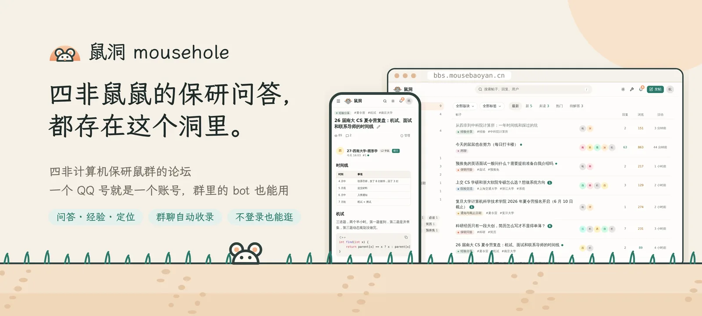
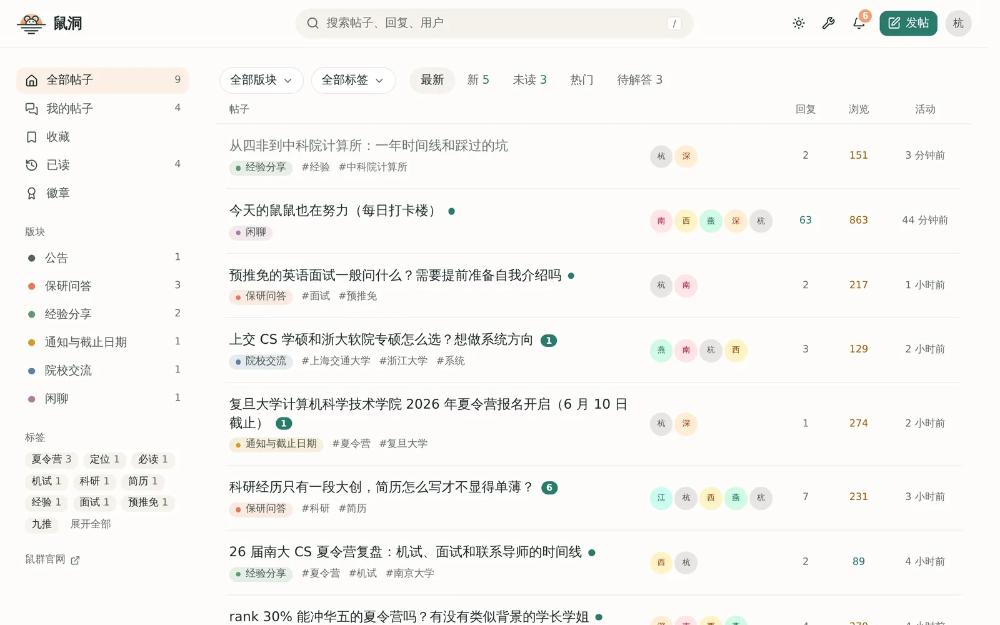
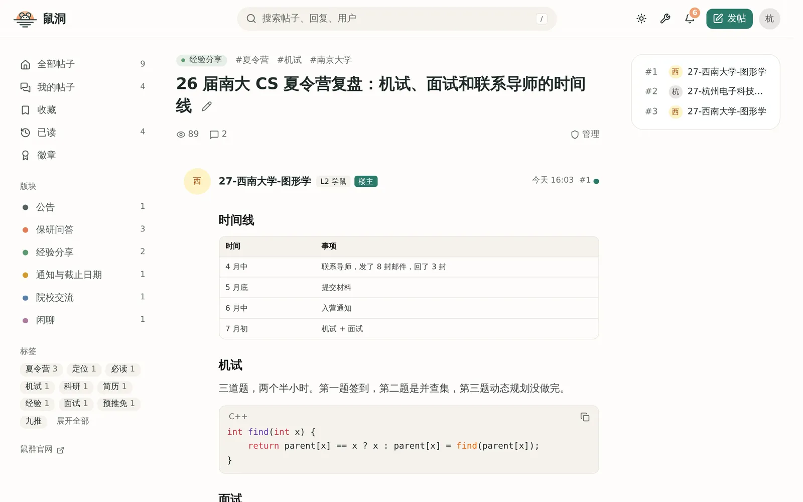
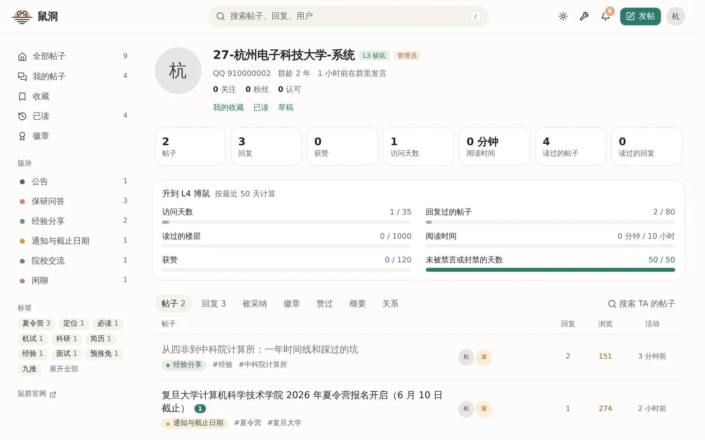
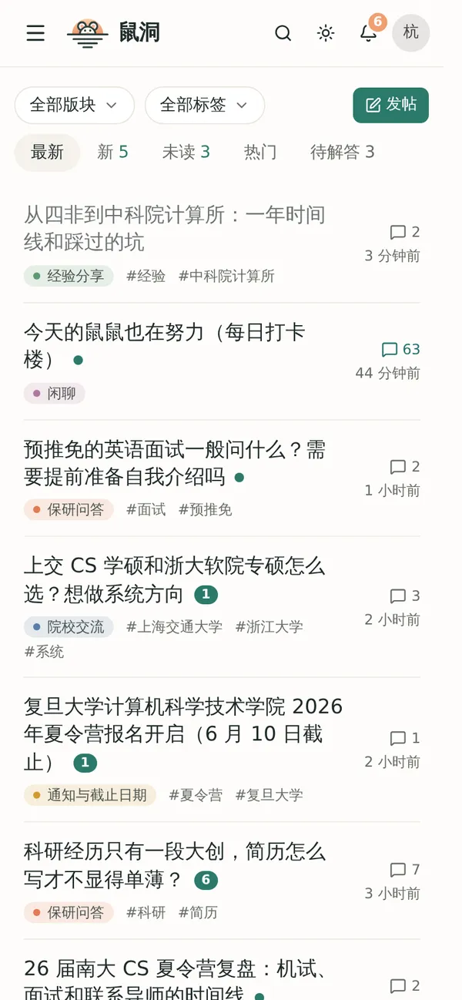
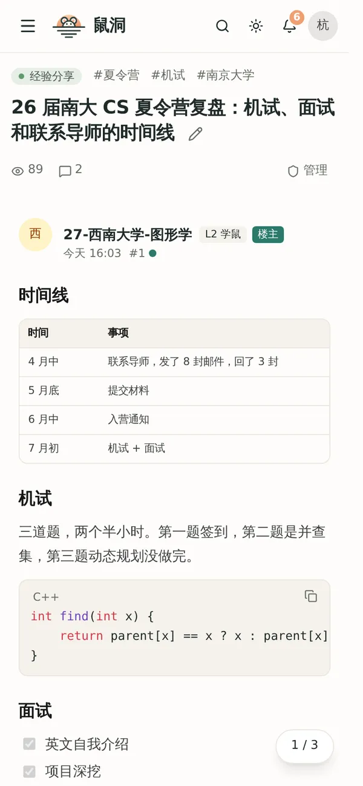
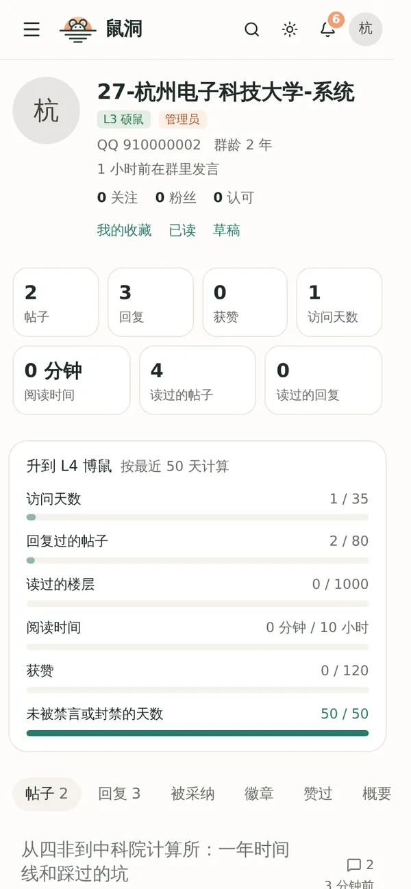
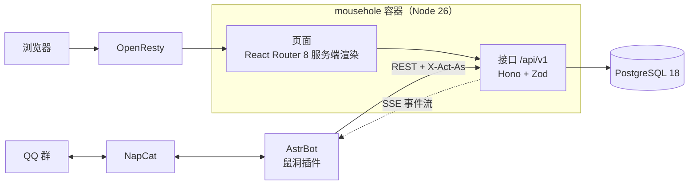

<div align="center">

<a href="https://bbs.mousebaoyan.cn"></a>

**四非计算机保研鼠群的论坛**

一个 QQ 号就是一个账号，群里的 AstrBot 插件能做网页上能做的一切。

[](https://github.com/mousebaoyan/mousehole/actions/workflows/ci.yml)
[](https://github.com/mousebaoyan/mousehole/tags)
[](LICENSE)
[](https://bbs.mousebaoyan.cn)

[进入鼠洞](https://bbs.mousebaoyan.cn) · [鼠群官网](https://mousebaoyan.cn/) · [AstrBot 插件](https://github.com/mousebaoyan/astrbot_plugin_mousehole) · [设计文档](docs/design.md)

</div>

## 为什么有鼠洞

保研群里每天都有好问题和好回答，但很快就被聊天刷上去，新人进群还得从头再问一遍。鼠洞把群里的内容沉淀成帖子，长期保留、能搜到，群被封也不会丢：

- **群的超集**：群里正经的提问和回答，由插件用大模型整理后自动收录成帖子和回复；论坛上也能独立发帖。
- **QQ 号即身份**：第一次登录就是注册，名字、头像、群头衔都和群里一致；退群自动冻结，回群自动恢复。
- **bot 就是另一种客户端**：网页和插件走同一套 `/api/v1`，插件可以指定以哪位群友的身份操作，并通过事件流收到论坛上发生的事。
- **轻量**：一个 Node 进程加 PostgreSQL，空载约 100MB 内存，在 25Mbps 的共享带宽上也跑得动。

## 看看样子

<picture>
  <source media="(prefers-color-scheme: dark)" srcset="docs/images/home-dark.webp">
  
</picture>

<table>
  <tr>
    <td width="50%">
      <picture>
        <source media="(prefers-color-scheme: dark)" srcset="docs/images/thread-dark.webp">
        
      </picture>
    </td>
    <td width="50%">
      <picture>
        <source media="(prefers-color-scheme: dark)" srcset="docs/images/profile-dark.webp">
        
      </picture>
    </td>
  </tr>
  <tr>
    <td align="center">帖子页：Markdown 正文、表格和代码高亮</td>
    <td align="center">个人主页：发帖统计、等级和升级进度</td>
  </tr>
</table>

<p align="center">
  <picture>
    <source media="(prefers-color-scheme: dark)" srcset="docs/images/phone-home-dark.webp">
    
  </picture>
  &nbsp;
  <picture>
    <source media="(prefers-color-scheme: dark)" srcset="docs/images/phone-thread-dark.webp">
    
  </picture>
  &nbsp;
  <picture>
    <source media="(prefers-color-scheme: dark)" srcset="docs/images/phone-profile-dark.webp">
    
  </picture>
</p>

<p align="center"><sub>截图用的是 <code>pnpm mock-bot seed</code> 生成的演示数据；跟随 GitHub 的浅色、深色主题切换。</sub></p>

## 功能

| 方面 | 能做什么 |
| --- | --- |
| 💬 **讨论与问答** | 版块和标签，楼中楼回复，采纳答案，表情回应，收藏和关注；Markdown 正文，图片自动转 WebP |
| 🎯 **保研特色** | 保研定位帖（填背景、大家给各校投票），投票帖，可复核的抽奖帖，匿名发帖和回复 |
| 🤖 **和 QQ 群打通** | 群成员同步、冻结与恢复，经 bot 的口令和链接登录，群聊自动收录，新回答提醒和开奖结果发回群里 |
| 🏅 **成长与装扮** | L0–L5 等级，徽章，鼠币签到和兑换，头像框、背景、主题色等个性化 |
| 🔎 **找得到** | 中文全文搜索，相似问题，AI 整理的帖子总结 |
| 🛡️ **管理** | 举报、禁言和封禁，审核状态，操作日志，后台的数据页和站点设置 |

每项的细节见[总体设计 §8](docs/design.md#8-内容)，进度见[路线图](docs/design.md#14-路线图)。

## 架构



页面在进程内调用同一套接口，所以网页能做的，bot 都能做。详见[总体设计 §4](docs/design.md#4-架构)。

**技术栈**：React 19 · React Router 8 · Hono · Zod 4 · TypeScript 7 · Tailwind CSS 4 · shadcn/ui（Base UI）· PostgreSQL 18 + Kysely · Vitest · Playwright · Docker。选型依据见[总体设计 §5](docs/design.md#5-技术选型)。

## 本地跑起来

需要 Node.js 26、pnpm 和 Docker。

```sh
cp .env.example .env
docker compose up -d          # 本地 PostgreSQL
pnpm install
pnpm dev                      # 启动时自动执行迁移

# 另开一个终端，造一个演示群和一些帖子
pnpm bootstrap --owner        # 站长的一次性登录链接
pnpm mock-bot setup           # 建 bot token，推送 30 个假群友
pnpm mock-bot seed            # 建演示用的版块、标签和帖子
pnpm mock-bot link 910000002  # 以一位演示群友的身份登录
```

提交前运行 `pnpm check`（类型检查、lint、格式和测试）。其余命令见 [AGENTS.md](AGENTS.md#命令)。

## 文档

| 文档 | 内容 |
| --- | --- |
| [总体设计](docs/design.md) | 目标、已定决策、架构、技术选型、成员与权限、等级、登录、内容、管理后台、性能、部署、安全、路线图 |
| [数据表](docs/data-model.md) | PostgreSQL 表结构、索引和查询约定 |
| [接口](docs/api.md) | 接口清单、bot 代操作、幂等、成员同步、事件流、登录与部署流程 |
| [开发约定](docs/development.md) | 目录、模块划分和分层，接口、数据库、前端、测试的写法，以及术语 |
| [AGENTS.md](AGENTS.md) | 参与开发的规矩：文档索引、写代码和测试的要求，分支、提交和 PR 的约定，人和编码 agent 都适用 |

## 相关项目

- [astrbot_plugin_mousehole](https://github.com/mousebaoyan/astrbot_plugin_mousehole)：群里的 AstrBot 插件，负责成员同步、私聊登录和自动收录
- [鼠群官网](https://mousebaoyan.cn/)（[源码](https://github.com/mousebaoyan/mousebaoyan.github.io)）

## 许可证

[MIT](LICENSE)
