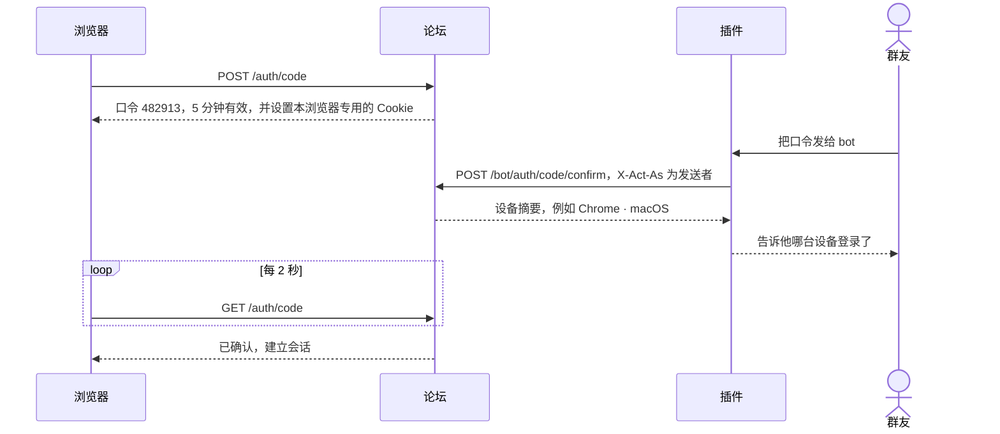
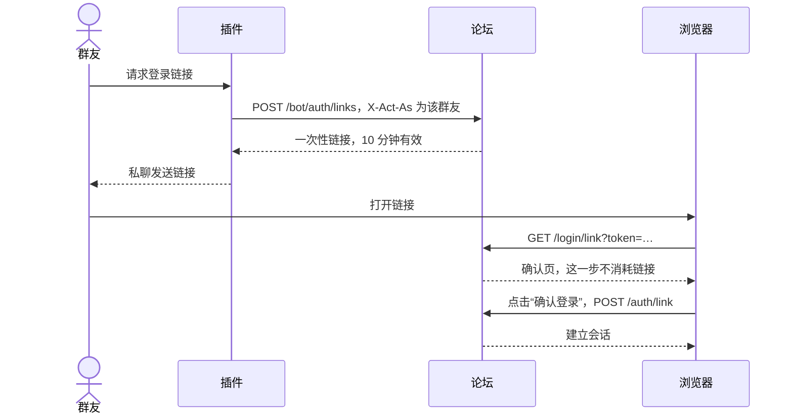
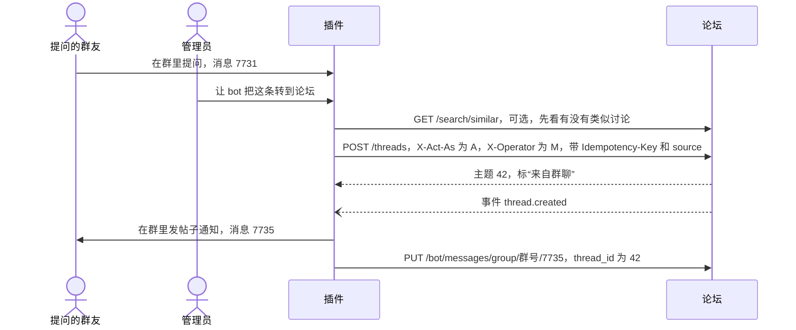
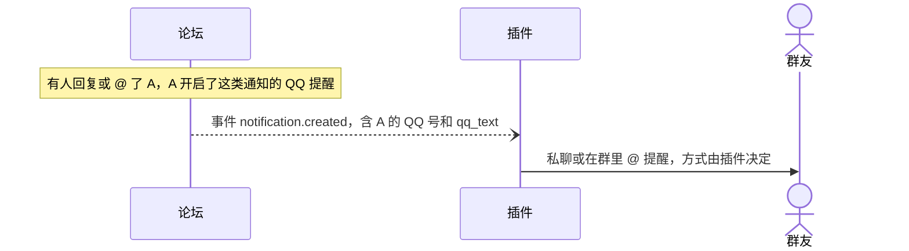
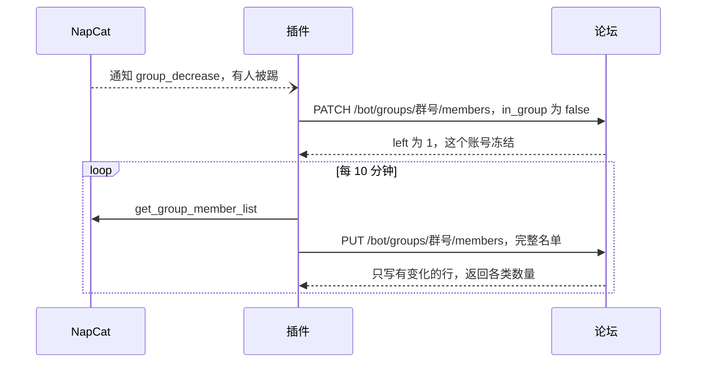

# 接口

> 状态：草案。开发后以运行时生成的 OpenAPI 为准：`/api/v1/openapi.json`，文档页 `/api/docs`。

## 1. 约定

- **地址**：`https://bbs.mousebaoyan.cn/api/v1`。下文的路径都省略 `/api/v1` 前缀。
- **格式**：请求和响应都是 JSON，字段用 snake_case，时间是 Unix 秒。请求体较大时可以用 `Content-Encoding: gzip` 压缩；响应按 `Accept-Encoding` 用 Brotli 或 gzip 压缩。
- **正文**：回复默认只带渲染好的 `html`；带 `?body=markdown` 时改为只带 Markdown 原文 `body`，插件转发到 QQ、网页编辑时用。
- **认证**：网页用 Cookie 会话（名为 `session`，HttpOnly、SameSite=Lax，90 天有效，超过一小时没用过的会话在下次使用时续期）；bot 用 `Authorization: Bearer <token>`。
- **指代用户**：路径、请求头和请求体里的用户，可以写论坛用户 ID（`123`），也可以写 QQ 号（`qq:123456789`）。
- **QQ 号**：返回给已登录的成员、bot 和管理员；访客和冻结的账号看不到（站点设置可以改成公开）。
- **分页**：列表返回 `{ "items": [...], "next_cursor": "..." }`，取下一页时带 `?cursor=`。主题里的楼层用 `?page=`，每页 30 层。
- **错误**：HTTP 状态码加 `{ "error": { "code": "thread_locked", "message": "主题已锁定" } }`。`code` 固定不变，插件据此判断；`message` 给人看，以后可能调整。各接口都可能返回的错误码：`invalid_request`（400，参数不对，`message` 指出哪个字段）、`unauthorized`（401，没有登录）、`not_found`（404）、`internal_error`（500）。
- **限流**：按 IP、用户和 token 分别限流，超出时返回 `429` 和 `Retry-After`。
- **CSRF**：网页的写请求校验 Origin；带 Bearer token 的请求不受影响。

### 主要对象（节选）

```jsonc
// 用户。qq、member_status、activated 只返回给成员、bot 和管理员
{ "id": 7, "display_name": "鼠鼠", "avatar_url": "/avatars/7.webp?v=3", "role": "user",
  "qq": 123456789, "card": "26-某某大学-CV", "level": 5, "level_name": "活跃", "title": "26届",
  "joined_at": 1740000000, "member_status": "member", "activated": true }

// 主题。匿名主题的 author 为 null
{ "id": 42, "board": { "slug": "qa", "name": "保研问答", "color": "#e07b53" }, "kind": "question",
  "title": "rank 30% 能冲夏令营吗", "author": { … }, "tags": ["夏令营"],
  "pinned": 0, "featured": false, "locked": false, "status": "visible", "solved_post_id": null,
  "reply_count": 5, "view_count": 120, "like_count": 3,
  "last_post_at": 1760000000, "created_at": 1759990000, "url": "https://bbs.mousebaoyan.cn/t/42" }

// 回复。source 只返回给 bot 和管理员；正文只带 html 或 body 中的一个，见上面的「正文」
{ "id": 108, "thread_id": 42, "floor": 3, "parent_id": null, "reply_to_id": null,
  "author": { … }, "html": "<p>…</p>", "via": "qq",
  "source": { "chat_type": "group", "chat_id": 987654321, "message_id": 7731 },
  "status": "visible", "reactions": { "+1": 2 }, "my_reactions": ["+1"], "sub_count": 1,
  "boosts": [ { "id": 31, "user": { … }, "body": "学到了", "created_at": 1760000100 } ],
  "boost_count": 9, "my_boost": "已收藏",
  "edited_at": null, "created_at": 1760000000 }
```

## 2. bot 认证与代操作

### 2.1 token 与权限范围

token 由管理员在后台创建，只显示一次。一个 token 可以有多个范围：

| 范围 | 允许 |
| --- | --- |
| `read` | 读取全部内容，包括仅成员版块和 QQ 号 |
| `act` | 以群友身份做普通操作：发帖、回复、编辑、删除、点赞、短评、收藏、关注、举报、上传、读通知 |
| `moderate` | 版主操作：审核（通过、隐藏）、置顶、精华、锁定、移动、删除短评、处理举报、禁言、管理标签 |
| `admin` | 管理员操作：封禁、设置角色、管理版块、站点设置、关联 QQ 群、查看操作日志 |
| `sync` | 推送 QQ 群资料和成员数据 |
| `auth` | 确认登录口令、签发登录链接 |
| `events` | 订阅事件流 |

### 2.2 请求头

| 请求头 | 说明 |
| --- | --- |
| `X-Act-As: qq:号码` | 以这位成员的身份操作。不带时，以 bot 自己的账号操作 |
| `X-Operator: qq:号码` | 让 bot 执行这次操作的人，写入审计日志 |
| `Idempotency-Key` | 防止重试导致重复执行，见 2.4 |

### 2.3 规则

- **权限取交集**：以 bot 自己的账号操作时，能做什么由 token 的范围决定；代表某位成员时，还要这位成员自己有这个权限。例如代表普通成员时，即使 token 有 `moderate`，也不能锁帖。
- **只能代表成员**：被代表的人必须是同步过、没注销的账号，否则返回 `404 unknown_member`。冻结的账号只能读，写操作返回 `403 member_frozen`。有人刚进群、论坛还没同步到时，插件先推送一条增量。
- **代发开关**：成员关闭"允许代发"后，只有他本人让 bot 操作（`X-Operator` 就是本人）时才放行，否则写操作返回 `403 proxy_disabled`。读操作不受影响。
- **操作人校验**：带 `X-Operator` 时，论坛会检查操作人有没有资格：代表别人操作时，操作人必须是版主或管理员；以 bot 账号执行管理操作时，操作人自己必须有这个权限。不通过返回 `403 operator_not_allowed`。没有操作人的场景（例如定时任务）可以不带这个头；后台可以设为必须带。
- **来源标注**：代表成员发的内容，带来源消息时 `via` 为 `qq`，页面标"来自群聊"；否则为 `bot`，标"由机器人代发"。本人可以编辑和删除。
- **审计**：经由 bot 的写操作都写入审计日志，记录以谁的身份、操作人、token、来源消息和 IP。

### 2.4 幂等

- 所有 `POST` 请求都可以带 `Idempotency-Key`，最长 128 个字符，建议用 `qq-{群号}-{消息ID}-{动作}`。
- 同一个 token 用同一个键在 7 天内再次请求时，直接返回第一次的结果，不会重复执行。
- 第一次请求还在处理时（例如正在下载图片），重复请求返回 `409 idempotency_in_progress`，稍后重试即可。处理中超过 5 分钟视为中断，可以重新执行。
- 同一个键用在别的接口上，返回 `422 idempotency_key_reused`。
- 另外，如果创建请求带的 `source` 已经对应了论坛内容，返回 `409 source_exists` 并附上已有的对象，避免同一条群消息被转两次。

### 2.5 内容格式

发主题、回复和编辑时，`content` 三选一：

```jsonc
{ "markdown": "正文……" }
{ "onebot": [ { "type": "text", "data": { "text": "……" } } ] }
{ "chat_log": [ { "qq": 123456789, "name": "鼠鼠", "time": 1760000000, "message": [ … ] } ] } // 二期
```

`onebot` 是 OneBot v11 的消息段数组，由论坛负责转换：

| 消息段 | 转换方式 |
| --- | --- |
| `text` | 原样显示，转义 Markdown 符号，保留换行 |
| `image`、`mface` | 论坛立即下载转存（QQ 图片链接会过期）；下载失败时显示"[图片已失效]" |
| `face` | QQ 经典表情；一期显示为"[表情]"，二期换成表情图 |
| `at` | 已同步的成员转为 @论坛用户，并触发提醒；`all` 忽略；其他显示为"@昵称" |
| `reply` | 被回复的消息对应论坛内容时，转为引用；否则忽略 |
| 其他（`file`、`video`、`record`、`json` 等） | 显示为"[文件] 文件名"之类的占位文字 |

`chat_log` 用来发"聊天记录帖"（`kind: "chatlog"`，二期），每条消息的 `message` 同样是 OneBot 消息段。插件把合并转发的节点展开后传进来即可。

`source` 表示内容来自哪条 QQ 消息：

```json
{ "chat_type": "group", "chat_id": 987654321, "message_id": 7731 }
```

## 3. 接口清单

"权限"一栏写的是：网页用户需要的身份 / bot token 需要的范围。这里的"成员"指已登录、没被冻结的账号。

### 3.1 登录与账号

| 方法 | 路径 | 说明 | 权限 |
| --- | --- | --- | --- |
| POST | `/auth/code` | 申请登录口令，返回 `code`、`expires_at` 和提示文案，同时给这个浏览器设置一个 Cookie | 访客 |
| GET | `/auth/code` | 浏览器轮询口令状态；确认后建立会话，返回当前用户 | 发起口令的浏览器 |
| POST | `/bot/auth/code/confirm` | `{ code }`：以 `X-Act-As` 的身份登录发起口令的浏览器，返回该浏览器的设备摘要 | `auth` |
| POST | `/bot/auth/links` | 给 `X-Act-As` 的成员签发一次性登录链接，10 分钟有效 | `auth` |
| POST | `/auth/link` | `{ token }`：使用登录链接，建立会话，返回 204；链接无效、用过或过期返回 `400 login_link_invalid` | 访客 |
| POST | `/auth/email` | `{ qq }`：把验证码发到 `QQ号@qq.com`；没同步过的 QQ 号返回 `403 not_member` | 访客 |
| POST | `/auth/email/verify` | `{ qq, code }`：校验验证码，建立会话 | 访客 |
| POST | `/auth/logout` | 退出当前会话；没有登录时也返回成功 | 访客 |
| GET | `/me` | 当前用户；bot 代表某人时返回这个人 | 已登录 / `read` |
| PATCH | `/me` | 修改显示名、简介、是否允许代发、提醒偏好 | 成员 / `act` |
| GET | `/me/sessions` | 已登录的设备 | 已登录 |
| DELETE | `/me/sessions/{id}` | 让某个设备下线 | 已登录 |
| GET | `/me/export` | 导出自己的全部内容 | 已登录，冻结了也可以 |
| DELETE | `/me` | 注销账号：`{ keep_content }`，`true` 保留内容、署名改为"已注销用户"，`false` 一并删除 | 已登录，冻结了也可以 |

三种登录方式都可以在后台单独关闭，关闭后对应接口返回 `403 login_method_disabled`。冻结的账号可以登录，但只能使用上表中标明"冻结了也可以"的接口，其他和访客一样。

### 3.2 用户

| 方法 | 路径 | 说明 | 权限 |
| --- | --- | --- | --- |
| GET | `/users/{user}` | 资料卡：显示名、头像、角色、QQ 号、群名片、群等级、专属头衔、入群时间、是否已冻结、统计 | 访客 |
| GET | `/users/{user}/threads` | 发过的主题，不含匿名内容 | 访客 |
| GET | `/users/{user}/posts` | 发过的回复，不含匿名内容 | 访客 |
| PATCH | `/users/{user}` | 设置角色、锁定角色 | 管理员 / `admin` |
| PUT | `/users/{user}/restriction` | 禁言或封禁：`{ type, until, reason }`，`type` 为 `mute` 或 `ban` | 禁言：版主 / `moderate`；封禁：管理员 / `admin` |
| DELETE | `/users/{user}/restriction` | 解除禁言或封禁 | 同上 |

### 3.3 版块与标签

| 方法 | 路径 | 说明 | 权限 |
| --- | --- | --- | --- |
| GET | `/boards` | 版块列表；访客看不到仅成员版块 | 访客 |
| GET | `/boards/{slug}` | 版块信息 | 访客 |
| POST | `/boards` | 新建版块 | 管理员 / `admin` |
| PATCH | `/boards/{slug}` | 修改版块，包括颜色、可见范围和审核方式 | 管理员 / `admin` |
| DELETE | `/boards/{slug}` | 删除空版块 | 管理员 / `admin` |
| GET | `/tags` | 标签列表，可按类别（话题、院校、方向）筛选 | 访客 |
| POST | `/tags` | 新建标签 | 版主 / `moderate` |
| PATCH | `/tags/{id}` | 改名、改类别、合并到另一个标签 | 版主 / `moderate` |
| DELETE | `/tags/{id}` | 删除标签 | 版主 / `moderate` |

### 3.4 主题

| 方法 | 路径 | 说明 | 权限 |
| --- | --- | --- | --- |
| GET | `/threads` | 主题列表：`board`、`tag`、`author`、`kind`、`sort`、`cursor`。`sort` 可选 `latest`（最新回复）、`new`（最新发布）、`hot`（热门）、`unsolved`（待解答） | 访客 |
| POST | `/threads` | 发主题：`board`、`title`、`content`、`kind`、`tags`、`source` | 成员 / `act` |
| GET | `/threads/{id}` | 主题详情，含主楼 | 访客 |
| PATCH | `/threads/{id}` | 作者可以改标题和标签；版主还可以改版块、置顶、精华、锁定、`status`（审核通过或隐藏） | 作者、版主 / `act`、`moderate` |
| DELETE | `/threads/{id}` | 删除主题；有人回复后作者不能删，只有版主能删 | 作者、版主 / `act`、`moderate` |
| PUT | `/threads/{id}/solution` | 采纳答案：`{ post_id }` | 主题作者、版主 / `act`、`moderate` |
| DELETE | `/threads/{id}/solution` | 取消采纳 | 同上 |
| PUT | `/threads/{id}/subscription` | 关注级别：`{ level }`，可选 `watching`、`normal`、`muted` | 成员 / `act` |
| PUT | `/threads/{id}/bookmark` | 收藏 | 成员 / `act` |
| DELETE | `/threads/{id}/bookmark` | 取消收藏 | 成员 / `act` |
| PUT | `/threads/{id}/read` | 记录已读到第几楼：`{ floor }` | 成员 |
| GET | `/threads/{id}/stream` | SSE：这个主题的新回复、编辑和删除 | 访客 |

主楼正文用 `PATCH /posts/{主楼 ID}` 修改。

### 3.5 回复

| 方法 | 路径 | 说明 | 权限 |
| --- | --- | --- | --- |
| GET | `/threads/{id}/posts` | 楼层列表：`page`（每页 30 层），每层附前 3 条楼中楼 | 访客 |
| POST | `/threads/{id}/posts` | 回复：`content`、`parent_id`（发楼中楼时填楼层 ID）、`reply_to_id`（回复或引用某一条）、`source` | 成员 / `act` |
| GET | `/posts/{id}` | 单条回复，附所在楼层号和页码，方便跳转 | 访客 |
| GET | `/posts/{id}/replies` | 某一层的全部楼中楼：`cursor` | 访客 |
| PATCH | `/posts/{id}` | 作者修改 `content`，保留编辑记录；版主还可以改 `status`（审核通过或隐藏），可附 `reason` | 作者、版主 / `act`、`moderate` |
| DELETE | `/posts/{id}` | 删除；楼层号保留，显示"该楼已删除" | 作者、版主 / `act`、`moderate` |
| GET | `/posts/{id}/revisions` | 编辑记录 | 作者、版主 / `read` |
| PUT | `/posts/{id}/reactions/{emoji}` | 点赞（`+1`）或表情回应 | 成员 / `act` |
| DELETE | `/posts/{id}/reactions/{emoji}` | 取消 | 成员 / `act` |
| GET | `/posts/{id}/reactions` | 谁回应了什么 | 访客 |
| POST | `/posts/{id}/report` | 举报：`{ reason }` | 成员 / `act` |
| PUT | `/posts/{id}/boost` | 留下或修改自己在这一层的短评：`{ body }`，不超过 16 个字；楼中楼返回 `422 boost_not_allowed` | 成员 / `act` |
| DELETE | `/posts/{id}/boost` | 删除自己的短评 | 成员 / `act` |
| GET | `/posts/{id}/boosts` | 这一层的全部短评，按时间排序；楼层列表里每层只带前 6 条 | 访客 |
| DELETE | `/boosts/{id}` | 删除任意短评，可附 `reason` | 版主 / `moderate` |
| POST | `/boosts/{id}/report` | 举报短评：`{ reason }` | 成员 / `act` |

### 3.6 搜索

| 方法 | 路径 | 说明 | 权限 |
| --- | --- | --- | --- |
| GET | `/search` | `q`、`board`、`tag`、`author`、`kind`、`cursor`；返回主题和高亮片段 | 访客 |
| GET | `/search/similar` | `text`：一段提问原文；返回最相似的 5 个主题和得分 | 访客 |

### 3.7 上传

| 方法 | 路径 | 说明 | 权限 |
| --- | --- | --- | --- |
| POST | `/uploads` | 用 multipart 上传图片，返回 `id`、`url`、`width`、`height` | 成员 / `act` |
| POST | `/uploads/fetch` | `{ url }`：论坛下载并转存，只接受 QQ 的图片域名 | `act` |

一般不需要单独调用 `/uploads/fetch`：`content.onebot` 里的图片会自动转存。

### 3.8 通知

| 方法 | 路径 | 说明 | 权限 |
| --- | --- | --- | --- |
| GET | `/notifications` | 通知列表：`unread_only`、`cursor` | 成员 / `act` |
| GET | `/notifications/unread-count` | 未读数 | 成员 / `act` |
| POST | `/notifications/read` | 标为已读：`{ ids }` 或 `{ all: true }` | 成员 / `act` |
| GET | `/stream` | SSE：当前用户的新通知和未读数 | 成员 |

### 3.9 管理后台

| 方法 | 路径 | 说明 | 权限 |
| --- | --- | --- | --- |
| GET | `/admin/overview` | 概览：成员数和已激活数、今日新帖、待审核和举报数、各群同步状态、事件流是否在线、数据库和图片占用 | 管理员 / `admin` |
| GET | `/admin/settings` | 站点设置：站点信息、登录方式、SMTP、QQ 号可见范围、默认审核方式、等级名称等；密码类字段只返回是否已设置 | 管理员 / `admin` |
| PATCH | `/admin/settings` | 修改站点设置，立即生效 | 管理员 / `admin` |
| POST | `/admin/settings/test-email` | `{ qq }`：用当前 SMTP 设置发一封测试邮件 | 管理员 / `admin` |
| GET | `/admin/groups` | 已关联的群和同步状态：最近一次增量、全量、群资料的时间，被拦下的全量 | 管理员 / `admin` |
| POST | `/admin/groups` | 关联群：`{ group_id }` | 管理员 / `admin` |
| PATCH | `/admin/groups/{group_id}` | 启用、停用、设为主群 | 管理员 / `admin` |
| GET | `/admin/members` | 成员列表：按 QQ 号、名字、成员资格、角色筛选 | 版主 / `moderate` |
| GET | `/admin/pending` | 待审核的主题和回复 | 版主 / `moderate` |
| GET | `/admin/reports` | 举报列表：`status` | 版主 / `moderate` |
| PATCH | `/admin/reports/{id}` | 处理举报：`{ status }`，可选 `resolved`、`dismissed` | 版主 / `moderate` |
| GET | `/admin/audit-logs` | 操作日志，可以按操作人、对象、动作筛选 | 管理员 / `admin` |
| GET、POST、DELETE | `/admin/tokens` | 管理 bot token | 管理员，只能在网页上操作 |

审核通过或隐藏内容，用 `PATCH /threads/{id}` 或 `PATCH /posts/{id}` 修改 `status`。

### 3.10 bot 专用

| 方法 | 路径 | 说明 | 权限 |
| --- | --- | --- | --- |
| GET | `/bot/groups` | 已关联且启用的群，附各自最近一次同步的时间 | `sync` |
| PUT | `/bot/groups/{group_id}/info` | 推送群资料，见 4.4 | `sync` |
| PUT | `/bot/groups/{group_id}/members` | 全量同步成员，见第 4 节 | `sync` |
| PATCH | `/bot/groups/{group_id}/members` | 增量同步成员，见第 4 节 | `sync` |
| GET | `/bot/messages/{chat_type}/{chat_id}/{message_id}` | 某条 QQ 消息对应的论坛主题或回复 | `read` |
| PUT | `/bot/messages/{chat_type}/{chat_id}/{message_id}` | 记录 bot 发出的帖子通知：`{ thread_id, post_id? }` | `act` |
| GET | `/bot/events` | SSE 事件流，见第 5 节 | `events` |
| GET | `/bot/events/batch` | 按游标拉取事件：`after`、`limit`，返回 JSON | `events` |

## 4. 成员同步

推荐的同步频率见[总体设计 · 群信息同步](design.md#63-群信息同步)。

### 4.1 全量和增量

```http
PATCH /api/v1/bot/groups/987654321/members
Authorization: Bearer <bot token>
Content-Type: application/json

{
  "observed_at": 1760000000,
  "members": [
    { "user_id": 123456789, "in_group": false, "left_reason": "kick" }
  ]
}
```

- **`observed_at`**：插件读到这些数据的时间。增量用 QQ 通知里的 `time`，全量用调用 `get_group_member_list` 的时间。论坛只接受比自己已有数据新的推送，到达顺序乱了也没关系。
- **全量（`PUT`）**：`members` 是完整名单。名单里有的人视为在群里；名单里没有、而且论坛已有数据比这次全量旧的人，标记为退群，原因记为未知。
- **增量（`PATCH`）**：只处理列出的人。`in_group: false` 表示退群，`true` 表示进群；不带 `in_group` 时只更新资料。没见过的 QQ 号会新建账号。
- **字段**：没带的字段保持原值，所以频繁的推送可以只带少量字段。论坛只写有变化的行，并返回各类数量：

```json
{ "joined": 1, "left": 0, "updated": 3, "unchanged": 1996, "stale": 0, "held": false }
```

`stale` 是比论坛已有数据旧、因此被忽略的条数；`held` 为 `true` 表示这次全量因为名单骤减被拦下了，见 4.3。

### 4.2 成员记录

字段名和 NapCat `get_group_member_list` 返回的一致，可以原样转发，多出来的字段会被忽略。

| 字段 | 说明 |
| --- | --- |
| `user_id` | QQ 号，必填 |
| `nickname` | QQ 昵称 |
| `card` | 群名片 |
| `role` | `owner`、`admin` 或 `member` |
| `title` | 专属头衔 |
| `level` | 群等级，按数字解析 |
| `join_time` | 入群时间，Unix 秒 |
| `last_sent_time` | 最后发言时间，Unix 秒；论坛按小时取整后存 |
| `is_robot` | 是否机器人 |
| `in_group` | 仅增量：`true` 进群，`false` 退群 |
| `left_reason` | 仅增量退群时：`leave` 主动退群，`kick` 被踢 |

QQ 通知可以这样转成增量：

| QQ 通知（OneBot v11） | 推送的记录 |
| --- | --- |
| `group_increase` | `{ user_id, in_group: true }`。资料可以等下一次全量补上，也可以先查一次成员信息一起带上 |
| `group_decrease`，`sub_type` 为 `leave` | `{ user_id, in_group: false, left_reason: "leave" }` |
| `group_decrease`，`sub_type` 为 `kick` | `{ user_id, in_group: false, left_reason: "kick" }` |
| `group_admin`，`sub_type` 为 `set` 或 `unset` | `{ user_id, role: "admin" }` 或 `{ user_id, role: "member" }` |
| `group_card` | `{ user_id, card: card_new }` |
| 专属头衔变化 | `{ user_id, title }` |

### 4.3 名单骤减保护

- 一次全量要标记退群的人数超过当前成员数的 20% 时，这次只更新资料、不标记退群，返回 `held: true`，后台的同步状态里也会显示出来。
- 下一次全量如果仍然缺这么多人，就照常标记：连续两次都这样，说明是真的。
- 增量推送的退群不受这个限制。例如清理插件一次踢掉很多人时，照常生效。

### 4.4 群资料

`PUT /bot/groups/{group_id}/info`：把 `get_group_info` 的返回原样传入，再加上 `observed_at`。用到的字段是 `group_name`、`member_count`、`max_member_count`。

## 5. 事件流

```text
GET /api/v1/bot/events
Authorization: Bearer <token>
Last-Event-ID: 1023

id: 1024
event: post.created
data: {"post":{…},"thread":{…},"author":{…},"qq_text":"……","url":"https://bbs.mousebaoyan.cn/t/42?floor=3"}
```

- 带 `Last-Event-ID`（或 `?after=`）时，先补发之后的事件，再实时推送；都不带时只推新事件。
- 每 20 秒发一条心跳注释，防止代理断开连接。
- 事件保留 7 天。游标早于最早的事件时返回 `410 cursor_expired`，并附上当前最新的事件 ID，插件可以从那里重新开始。
- 至少投递一次：网络中断可能导致重复投递，插件按事件 ID 去重，处理完再保存游标。
- 用 `?types=thread.created,notification.created` 只订阅部分类型。

| 类型 | 触发时机 | 主要字段 |
| --- | --- | --- |
| `thread.created` | 新主题公开（先审后发的版块在审核通过时） | `thread`、`board`、`author`、`source`、`url`、`qq_text` |
| `post.created` | 新回复公开 | `post`、`thread`、`author`、`reply_to`（被回复的那条、它的作者和来源消息）、`source`、`url`、`qq_text` |
| `post.updated` | 回复或主楼被编辑 | `post`、`thread`、`editor` |
| `post.deleted` | 回复或主题被删除、隐藏 | `post_id`、`thread_id`、`by`、`reason` |
| `thread.solved` | 采纳答案 | `thread`、`post`、`answerer` |
| `content.pending` | 先审后发的版块有新内容等待审核 | `thread`、`post`、`author` |
| `notification.created` | 给某位成员产生通知，且他开启了这类通知的 QQ 提醒 | `user`、`type`、`actor`、`thread`、`post`、`url`、`qq_text` |
| `member.activated` | 成员第一次登录 | `user` |
| `report.created` | 有新举报 | `report`、`post`、`boost`（举报的是短评时）、`reporter` |

- `qq_text` 是可以直接发到 QQ 的纯文本，例如"【保研问答】rank 30% 能冲夏令营吗\n鼠鼠：……\nhttps://bbs.mousebaoyan.cn/t/42"。
- 事件里的用户对象都带 `qq`，插件可以直接 @ 或私聊。匿名内容（二期）的事件不带作者。
- 审核可以挂在事件上：先发后审的版块监听 `thread.created`、`post.created`，先审后发的版块监听 `content.pending`，判定后调用 `PATCH` 修改 `status`。

## 6. 流程

### 6.1 口令登录



- 口令只能确认一次，确认接口按 QQ 号限流。
- 设备摘要用来防骗：有人骗别人替他发送口令时，被骗的人会收到"某某设备已登录"的回复，可以马上去设置页让它下线。
- 提示文案在后台设置，例如"私聊机器人发送：登录 482913"。插件怎样识别口令，由插件决定。

### 6.2 一次性链接登录



链接必须点"确认登录"才生效。QQ 会提前抓取聊天里的链接来生成预览，如果打开链接就直接登录，链接会被预览抓取用掉。

### 6.3 QQ 邮箱验证码

1. 浏览器 `POST /auth/email`，提交 QQ 号。
2. 同步过的 QQ 号才会收到验证码，发到 `QQ号@qq.com`，10 分钟有效；没同步过的返回 `403 not_member`。冻结的账号也能收到，登录后只能管理自己的账号。
3. 浏览器 `POST /auth/email/verify`，提交 QQ 号和验证码；校验通过就建立会话，输错 5 次作废。

### 6.4 群里的提问转到论坛



### 6.5 群里的回复同步到论坛


反过来，论坛上有人回复了来自群聊的内容时，`post.created` 的 `reply_to.source` 带着原消息，插件可以在群里引用原消息，把这条回复转发回去。

### 6.6 通知转到 QQ



### 6.7 成员同步



### 6.8 首次部署

1. 部署后在容器里运行 `node scripts/bootstrap.ts --qq 你的QQ号`（本地开发用 `pnpm bootstrap --qq 你的QQ号`），得到一次性登录链接，10 分钟内有效。这个 QQ 号的账号设为管理员，并锁定角色。
2. 打开链接登录后台：关联 QQ 群、设主群，创建 bot token（按插件需要选择范围），配置 SMTP 并发一封测试邮件。
3. 把 token 配到插件里。插件推送第一次全量后，群成员就都能登录了。

## 7. 示例

以群友的身份发一个问答帖：

```http
POST /api/v1/threads
Authorization: Bearer <bot token>
X-Act-As: qq:123456789
X-Operator: qq:10001
Idempotency-Key: qq-987654321-7731-thread
Content-Type: application/json

{
  "board": "qa",
  "kind": "question",
  "title": "rank 30% 能冲夏令营吗",
  "content": { "onebot": [
    { "type": "text", "data": { "text": "……" } },
    { "type": "image", "data": { "url": "https://multimedia.nt.qq.com.cn/……" } }
  ] },
  "source": { "chat_type": "group", "chat_id": 987654321, "message_id": 7731 }
}
```

```http
HTTP/1.1 201 Created
Content-Type: application/json

{ "thread": { "id": 42, "url": "https://bbs.mousebaoyan.cn/t/42", … }, "post": { "id": 108, "floor": 1, "via": "qq", … } }
```
