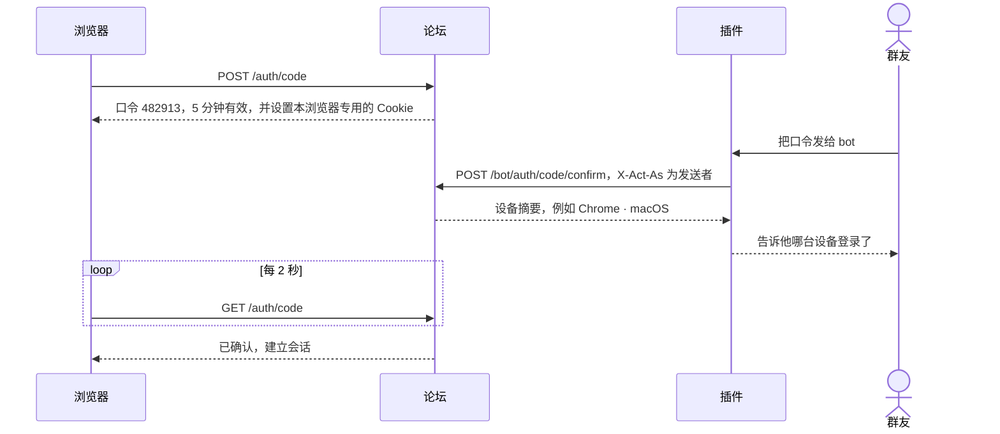
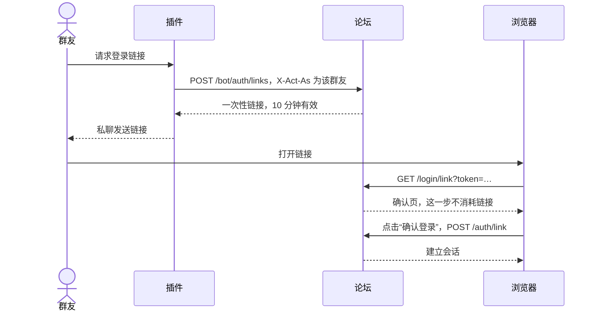
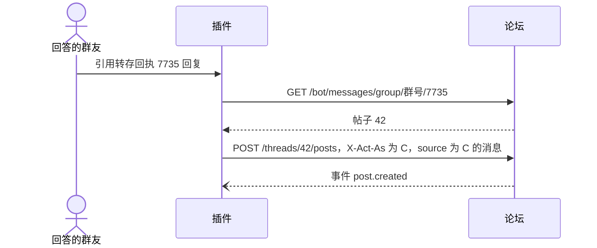
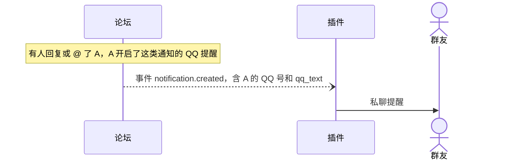
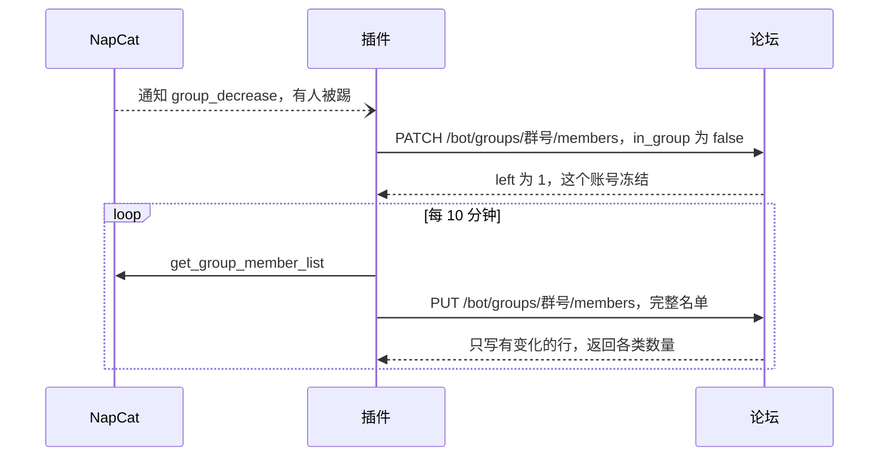

# 接口

> 状态：草案。开发后以运行时生成的 OpenAPI 为准：`/api/v1/openapi.json`，文档页 `/api/docs`。

## 1. 约定

- **地址**：`https://bbs.mousebaoyan.cn/api/v1`。下文的路径都省略 `/api/v1` 前缀。
- **格式**：请求和响应都是 JSON，字段用 snake_case，时间是 Unix 秒。请求体较大时可以用 `Content-Encoding: gzip` 压缩；响应按 `Accept-Encoding` 用 Brotli 或 gzip 压缩。请求体默认不超过 1MB，成员全量同步不超过 4MB，gzip 的按解压后的大小算，超出返回 `413 payload_too_large`。
- **正文**：楼层默认只带渲染好的 `html`；带 `?body=markdown` 时改为只带 Markdown 原文 `body`，网页编辑时用。
- **认证**：网页用 Cookie 会话（名为 `session`，HttpOnly、SameSite=Lax，90 天有效，超过一小时没用过的会话在下次使用时续期）；bot 用 `Authorization: Bearer <token>`。
- **指代用户**：路径、请求头和请求体里的用户，可以写论坛用户 ID（`123`），也可以写 QQ 号（`qq:123456789`）。
- **QQ 号**：返回给已登录的成员、bot 和管理员；访客和冻结的账号看不到（站点设置可以改成公开）。
- **分页**：列表返回 `{ "items": [...], "next_cursor": "..." }`，取下一页时带 `?cursor=`。帖子里的楼层不用游标，按楼层号取，见[楼层](#35-楼层)。
- **错误**：HTTP 状态码加 `{ "error": { "code": "thread_locked", "message": "帖子已锁定" } }`。`code` 固定不变，插件据此判断；`message` 给人看，以后可能调整。各接口都可能返回的错误码：`invalid_request`（400，参数不对，`message` 指出哪个字段）、`unauthorized`（401，没有登录）、`forbidden`（403，没有权限）、`level_required`（403，等级不够：L0 的链接数和每天的帖子、回复数，L2 才能发投票帖和抽奖帖，版块的阅读和发帖门槛，抽奖的参与等级；`message` 里有要几级）、`not_found`（404）、`internal_error`（500）。
- **限流**：按 IP、用户和 token 分别限流，超出时返回 `429 rate_limited` 和 `Retry-After`（秒）。
- **CSRF**：网页的写请求校验 Origin；带 Bearer token 的请求不受影响。

### 主要对象（节选）

```jsonc
// 用户。qq、member_status、activated 只返回给成员、bot 和管理员，站点设置 qq_public 打开时 qq 也返回给访客；avatar_url 是论坛缓存的 QQ 头像，还没拉到时为 null
{ "id": 7, "display_name": "鼠鼠", "avatar_url": "/avatars/7.webp?v=3", "role": "user",
  "qq": 123456789, "card": "26-某某大学-CV", "title": "26届",
  "joined_at": 1740000000, "member_status": "member", "activated": true }

// 版块。visibility：public 公开，members 仅成员；read_level：仅成员的版块还要几级才能看，0 不限；
// post_role：谁能发帖，user 成员、moderator 版主；post_level：成员要几级才能发帖，0 不限；版主和管理员不受等级限制；
// default_kind：发帖时默认的类型，discussion 讨论、question 问答；review_mode：after 先发后审，before 先审后发
{ "id": 2, "slug": "qa", "name": "保研问答", "description": "定位、材料、流程等问题", "color": "#e07b53",
  "visibility": "public", "read_level": 0, "post_role": "user", "post_level": 0,
  "default_kind": "question", "review_mode": "after", "thread_count": 1284 }

// 标签。kind：topic 话题、school 院校、major 方向
{ "id": 1, "name": "夏令营", "kind": "topic", "thread_count": 42 }

// 帖子和楼层里的用户只带这几项；level 是论坛等级 0–5（总体设计 §6.6）；title 是主群里的专属头衔，没有为空字符串
{ "id": 7, "display_name": "鼠鼠", "role": "user", "level": 3, "title": "26届" }

// 匿名写的人（总体设计 §8.12）：帖子、楼层、短评、通知和事件里的 author、user、actor 都可能是这个样子，
// number 是这个人在这个帖子里的编号，楼主匿名时是 1 号；没有 id、头像和 QQ 号
{ "anonymous": true, "number": 3, "display_name": "匿名鼠 3" }

// 帖子。kind：discussion 讨论、question 问答、poll 投票、lottery 抽奖；楼主匿名时 author 是匿名的样子；帖子详情里有 author_anonymous、anonymous_replies（楼主以外的人回复时匿名），
// 登录时还有 my_alias（自己在这个帖子里匿名时的编号，没有为 null）；floor_count 是最大的楼层号；帖子详情里的 solved_floor 是采纳的回答在第几楼，excerpt 是主楼正文的前 100 个字；pinned：0 不置顶，1 版块内置顶，2 全站置顶；
// posters 是楼主以外、最近 20 层里最近回复的最多 4 个人，不含匿名回复的；url 只在帖子详情里有；
// last_read_floor 是自己读过的最高一楼，没打开过为 0，只在登录时返回；帖子详情里还有 read_floors，是读过的楼层区间，例如 [[1, 20], [480, 495]]，
// 以及 bookmarked（是否收藏）和 notify_level（关注级别，见 /threads/{id}/subscription），也只在登录时返回；
// 帖子详情里的 poll 是投票帖的投票（见下面的「投票」），lottery 是抽奖帖的抽奖（见下面的「抽奖」），其他类型为 null；
// status：visible 公开，pending 待审核，hidden 已隐藏，后两种只有作者和版主能看到
{ "id": 42, "board": { "slug": "qa", "name": "保研问答", "color": "#e07b53" }, "kind": "question",
  "title": "rank 30% 能冲夏令营吗", "author": { … }, "posters": [ { … } ], "tags": ["夏令营"],
  "status": "visible", "pinned": 0, "featured": false, "locked": false, "solved_post_id": null,
  "reply_count": 5, "floor_count": 6, "view_count": 120, "like_count": 3, "last_read_floor": 4,
  "last_post_at": 1760000000, "created_at": 1759990000, "url": "https://bbs.mousebaoyan.cn/t/42" }

// 投票（总体设计 §8.11）。results：voted 投过票或结束后才看得到结果，always 随时公开；
// 还看不到结果时每项的 votes 为 null，voter_count（一共多少人投了票）总是有；closes_at 为 null 是不限时间；
// my_votes 是自己投的选项，没投为 []，访客为 null
{ "multiple": true, "max_choices": 2, "anonymous": false, "results": "voted",
  "closes_at": 1760600000, "closed": false, "voter_count": 12,
  "options": [ { "id": 5, "label": "1–3 个", "votes": 4 }, { "id": 6, "label": "4–6 个", "votes": 9 } ],
  "my_votes": [6] }

// 抽奖（总体设计 §8.13）。entry：button 点按钮参与，reply 开奖前回复过就算参与；min_level 参与要几级（版主和管理员不受限制）；
// prizes 按开奖的顺序排，won_by 是中奖的人、按抽中的先后，开奖前为 null；drawn_at 是实际开奖的时间，没开奖为 null；
// seed_hash 是种子的 SHA-256，发帖时就公布，seed 开奖后才有；entry_count 是参与人数，回复参与的开奖前现算；entered 是自己是否参与了，访客为 null。
// 复核：SHA-256(seed) 等于 seed_hash；参与的人按 SHA-256("seed:用户 ID") 的十六进制从小到大排，依次抽满各个奖项
{ "prizes": [ { "name": "一等奖：机械键盘", "winners": 1, "won_by": [ { … } ] },
              { "name": "二等奖：鼠群周边", "winners": 3, "won_by": [ { … }, { … }, { … } ] } ],
  "entry": "button", "min_level": 1, "draws_at": 1760600000, "drawn_at": 1760600030, "cancelled": false,
  "seed_hash": "9f86d0…", "seed": "3a7bd3…", "entry_count": 25, "entered": true }

// 楼层。source 只返回给 bot 和管理员；正文只带 html 或 body 中的一个，见上面的「正文」；
// 删除的楼层 deleted 为 true，正文为空字符串；status 同帖子，主楼的跟着帖子；
// 作者设置了不给访客看时，访客拿到的 members_only 为 true，正文为空，没有表情和短评（总体设计 §8.10）
{ "id": 108, "thread_id": 42, "floor": 3, "reply_to": { "id": 105, "floor": 2, "author": { … } },
  "author": { … }, "html": "<p>…</p>", "via": "qq", "deleted": false, "members_only": false,
  "source": { "chat_type": "group", "chat_id": 987654321, "message_id": 7731 },
  "status": "visible", "reactions": { "heart": 2, "+1": 1 }, "my_reaction": "heart", "reply_count": 1,
  "boosts": [ { "id": 31, "user": { … }, "body": "学到了", "created_at": 1760000100 } ],
  "boost_count": 9, "my_boost": "已收藏",
  "edited_at": null, "created_at": 1760000000 }

// 通知。type：reply 回复了我的楼层，mention @了我，like 赞了我的楼层，boost 给我的楼层留了短评，
// watching 关注的帖子有新楼层，following 关注的人发了新帖，solved 我的回答被采纳，
// moderation 版主审核或隐藏了我的内容（data 带 action：approve 通过、reject 不通过、hide 隐藏、unhide 恢复，以及 reason），
// level 我升级了（data 带 level，没有 actor、thread、post，都为 null），
// lottery 抽奖开奖或取消了（data 带 result：won 中奖、lost 没中、drawn 自己发起的开奖了、cancelled 取消了；中奖的还带 prize，奖项名；没有 actor、post）。
// like、boost 按楼层，watching 按帖子，
// 未读期间合并成一条：actor 是最近的人，count 是次数。post 是新的那一层，点赞和短评是被赞的那一层；
// excerpt 是它正文的前 80 个字，待审核和已隐藏的只给作者看，别人为空字符串；data 里点赞带最近的 emoji，短评带最近的 body
{ "id": 9001, "type": "like", "actor": { … }, "count": 3, "thread": { "id": 42, "title": "…" },
  "post": { "id": 108, "floor": 3 }, "excerpt": "……", "data": { "emoji": "heart" },
  "read": false, "created_at": 1760000000 }
```

## 2. bot 认证与代操作

### 2.1 token 与权限范围

token 由管理员在后台创建，只显示一次。每个 token 绑定一个 bot 账号：创建时填 bot 的 QQ 号，没同步过就先建号，角色固定为 `bot`；登录过的群友不能用作 bot，返回 `409 bot_qq_taken`。不带 `X-Act-As` 时以这个账号操作。token 无效或已吊销返回 `401 invalid_token`。

一个 token 可以有多个范围，接口要的范围不在其中时返回 `403 scope_missing`：

| 范围 | 允许 |
| --- | --- |
| `read` | 读取全部内容，包括仅成员版块和 QQ 号 |
| `act` | 以群友身份做普通操作：发帖、回复、编辑、删除、点赞、短评、收藏、关注、举报、上传、读通知 |
| `moderate` | 版主操作：审核（通过、隐藏）、置顶、精华、锁定、移动、删除短评、处理举报、禁言、管理标签 |
| `admin` | 管理员操作：封禁、设置角色、管理版块、站点设置、关联 QQ 群、查看操作日志 |
| `sync` | 推送 QQ 群资料和成员数据 |
| `auth` | 确认登录口令、签发登录链接 |
| `events` | 订阅事件流 |

### 2.2 请求头

| 请求头 | 说明 |
| --- | --- |
| `X-Act-As: qq:号码` | 以这位成员的身份操作。不带时，以 bot 自己的账号操作 |
| `X-Operator: qq:号码` | 让 bot 执行这次操作的人，写入审计日志 |
| `Idempotency-Key` | 防止重试导致重复执行，见 2.4 |

### 2.3 规则

- **权限取交集**：以 bot 自己的账号操作时，能做什么由 token 的范围决定；代表某位成员时，还要这位成员自己有这个权限。例如代表普通成员时，即使 token 有 `moderate`，也不能锁帖。
- **只能代表成员**：被代表的人必须是同步过的账号，否则返回 `404 unknown_member`。冻结的账号只能读，写操作返回 `403 member_frozen`。有人刚进群、论坛还没同步到时，插件先推送一条增量。
- **代发开关**：成员关闭"允许代发"后，只有他本人让 bot 操作（`X-Operator` 就是本人）时才放行，否则写操作返回 `403 proxy_disabled`。读操作不受影响。
- **操作人校验**：带 `X-Operator` 时，论坛会检查操作人有没有资格：代表别人操作时，操作人必须是版主或管理员；执行版主或管理员操作时，操作人自己也必须有这个权限。不通过返回 `403 operator_not_allowed`。没有操作人的场景（例如定时任务、成员同步）可以不带这个头；后台可以设为代表成员时必须带，没带的返回 `400 operator_required`，bot 以自己的账号操作不受影响。
- **来源标注**：代表成员发的内容，带来源消息时 `via` 为 `qq`，页面标"来自群聊"；否则为 `bot`，标"由机器人代发"。本人可以编辑和删除。
- **审计**：经由 bot 的写操作都写入审计日志，记录以谁的身份、操作人、token、来源消息和 IP。

### 2.4 幂等

- 所有 `POST` 请求都可以带 `Idempotency-Key`，最长 128 个字符，建议用 `qq-{群号}-{消息ID}-{动作}`。
- 同一个 token 用同一个键在 7 天内再次请求时，直接返回第一次的结果，不会重复执行。
- 第一次请求还在处理时（例如正在下载图片），重复请求返回 `409 idempotency_in_progress`，稍后重试即可。处理中超过 5 分钟视为中断，可以重新执行。第一次出了服务器错误（5xx）不算结果，重试会重新执行。
- 同一个键用在别的接口上，返回 `422 idempotency_key_reused`。
- 另外，如果创建请求带的 `source` 已经对应了论坛内容，返回 `409 source_exists`，和 `error` 并列附上已有内容的 `thread_id` 和 `post_id`，避免同一条群消息被转两次。

### 2.5 内容格式

发帖和回复时，`content` 三选一；编辑只接受 `markdown`：

```jsonc
{ "markdown": "正文……" }
{ "onebot": [ { "type": "text", "data": { "text": "……" } } ] }
{ "chat_log": [ { "qq": 123456789, "name": "鼠鼠", "time": 1760000000, "message": [ … ] } ] } // 二期
```

`markdown` 最长 30000 个字符，写法见[总体设计 §8.2](design.md#82-正文)。

`onebot` 是 OneBot v11 的消息段数组，由论坛负责转换：

| 消息段 | 转换方式 |
| --- | --- |
| `text` | 原样显示：转义 Markdown 符号（链接里的不转义，免得链接失效），行首的 `#`、`>`、`-`、`1.` 等不变成标题、引用和列表；保留换行 |
| `image`、`mface` | 论坛立即下载转存（QQ 图片链接几小时就过期），只接受 QQ 的图片域名；下载失败时显示"[图片已失效]"。`mface` 的 `summary` 作为图片说明 |
| `face` | QQ 经典表情；一期显示为"[表情]"，二期换成表情图 |
| `at` | 已同步的成员转为 @论坛用户，并触发提醒；`all` 忽略；其他显示为"@昵称"（`name`，没有就是"@群友"），不显示 QQ 号 |
| `reply` | 被回复的消息是同一个帖子里某一层的来源时，记为回复那一层（`reply_to`，请求里带了 `reply_to_id` 时以它为准）；否则忽略 |
| `file` | "[文件] 文件名" |
| `video`、`record`、`forward`、`json` | "[视频]""[语音]""[聊天记录]""[卡片]" |
| 其他 | "[消息]" |

转换后没有内容（例如只有一个 `@全体成员`）返回 `400 invalid_request`。带 `source` 的内容标为来自群聊（`via: "qq"`）。

`chat_log` 用来发"聊天记录帖"（`kind: "chatlog"`，二期），每条消息的 `message` 同样是 OneBot 消息段。插件把合并转发的节点展开后传进来即可。

`source` 表示内容来自哪条 QQ 消息：

```json
{ "chat_type": "group", "chat_id": 987654321, "message_id": 7731 }
```

## 3. 接口清单

"权限"一栏写的是：网页用户需要的身份 / bot token 需要的范围。这里的"成员"指已登录、没被冻结的账号。

### 3.1 登录与账号

| 方法 | 路径 | 说明 | 权限 |
| --- | --- | --- | --- |
| POST | `/auth/code` | 申请登录口令（6 位数字，5 分钟有效），返回 `code`、`expires_at` 和提示文案 `hint`，同时给这个浏览器设置 `login_code` Cookie；同一个 IP 10 分钟内最多 20 次 | 访客 |
| GET | `/auth/code` | 浏览器轮询口令状态：等待中返回 `{ status: "pending", code, expires_at, hint }`；bot 确认后建立会话，返回 `{ status: "confirmed" }`；没有有效口令返回 `410 login_code_expired` | 发起口令的浏览器 |
| POST | `/bot/auth/code/confirm` | `{ code }`：以 `X-Act-As` 的身份登录发起口令的浏览器，返回该浏览器的设备摘要 `{ device }`，例如 `Chrome · macOS`；口令无效、用过或过期返回 `404 login_code_invalid`；同一个人 10 分钟内最多确认 10 次 | `auth` |
| POST | `/bot/auth/links` | 给 `X-Act-As` 的成员签发一次性登录链接，返回 `{ url, expires_at }`，10 分钟有效；同一个人每小时最多 10 次 | `auth` |
| GET | `/auth/methods` | 开着的登录方式：`{ code, link, email }`；邮件服务没配置时 `email` 也是 `false` | 访客 |
| POST | `/auth/link` | `{ token }`：使用登录链接，建立会话，返回 204；链接无效、用过或过期返回 `400 login_link_invalid` | 访客 |
| POST | `/auth/email` | `{ qq }`：把验证码发到 `QQ号@qq.com`，返回 204；没同步过的 QQ 号返回 `403 not_member`；同一个 QQ 号 60 秒内只能发一次、每天最多 10 次，同一个 IP 10 分钟内最多 10 次；发信失败返回 `502 email_failed` | 访客 |
| POST | `/auth/email/verify` | `{ qq, code }`：校验验证码，建立会话，返回 204；不对、过期或输错 5 次作废都返回 `400 email_code_invalid`，`message` 说明是哪种 | 访客 |
| POST | `/auth/logout` | 退出当前会话；没有登录时也返回成功 | 访客 |
| GET | `/me` | 当前用户；bot 代表某人时返回这个人 | 已登录 / `read` |
| GET | `/me/settings` | 自己的设置：`custom_name`（自己起的名字，`null` 是跟着 QQ）、`custom_bio`（自己写的个性签名，`null` 是跟着 QQ）、`qq_bio`（QQ 的个性签名）、`avatar_custom`（头像是不是自己上传的）、`allow_proxy`、`hide_from_guests`（我的内容不给访客看）、`notify_prefs`（每类通知的 `{ site, qq }` 开关，含默认值） | 已登录 / `read` |
| PATCH | `/me` | 修改设置，只改带了的字段，返回改好的设置：`custom_name`（最多 24 个字，`null` 改回跟着 QQ，显示名随即重算）、`custom_bio`（最多 60 个字，`null` 改回跟着 QQ）、`allow_proxy`、`hide_from_guests`、`notify_prefs`（带了的类型整体替换）。插件的"不给访客看"命令用 `X-Act-As` 代成员改 `hide_from_guests`，没登录过论坛的也可以 | 成员 / `act` |
| PUT | `/me/avatar` | 上传头像：multipart 的 `file` 字段，最大 20MB，格式同图片上传，裁成 96px 的方图；之后不再跟着 QQ 刷新。返回 `{ avatar_url }` | 没被禁言的成员 / `act` |
| DELETE | `/me/avatar` | 头像改回跟着 QQ，立刻拉一次 QQ 头像，返回 `{ avatar_url }`；拉取失败返回 `502 fetch_failed`，头像不变 | 成员 / `act` |
| GET | `/me/export` | 导出自己的全部内容，作为附件 `mousehole-{id}.json` 下载：`user`（`id`、`qq`、`display_name`、`bio`）、`posts`（发过的主楼和回复，Markdown 原文，含待审核和已隐藏的，不含删掉的；`floor` 为 1 的就是自己发的帖子）、`boosts`、`bookmarks`；每小时最多 3 次 | 已登录，只能在网页上 |
| GET | `/me/drafts` | 自己的草稿，最近改过的在前：`thread`（回复的帖子 `{ id, title }`，发帖的为 `null`）、`title`、`excerpt`（正文前 100 个字）、`updated_at` | 已登录，只能在网页上 |
| GET | `/me/drafts/{key}` | 一份草稿，`key` 为 `new` 是发帖的，为帖子 ID 是回复这个帖子的：`title`、`board`、`kind`、`poll`（写了一半的投票，选项可以是空的；截止时间是 `days`（选了几天后截止，发帖时从那时算起）或 `closes_at`（自定义的时间），其余字段同发帖；没有为 `null`）、`lottery`（写了一半的抽奖，奖品可以是空的；开奖时间是 `days` 或 `draws_at`，同投票；没有为 `null`）、`tags`、`author_anonymous`、`anonymous_replies`、`body`、`reply_to`（`{ id, floor, name }` 或 `null`）、`updated_at`；没有返回 `404 draft_not_found` | 已登录，只能在网页上 |
| PUT | `/me/drafts/{key}` | 保存草稿，整份替换：`{ body, title?, board?, kind?, poll?, lottery?, tags?, author_anonymous?, anonymous_replies?, reply_to_id? }`；回复的帖子不存在返回 `404`，不在这个帖子里的 `reply_to_id`、不存在的版块不保存。发帖、回复成功后论坛删掉对应的草稿，180 天没动过的每天清理 | 已登录，只能在网页上 |
| DELETE | `/me/drafts/{key}` | 放弃草稿 | 已登录，只能在网页上 |
| GET | `/me/sessions` | 已登录的设备：`user_agent`、`device`（例如"Chrome · macOS"）、`ip`、时间、是否当前设备 | 已登录 |
| DELETE | `/me/sessions/{id}` | 让某个设备下线 | 已登录 |

禁言中的成员发帖、回复、编辑、点赞、短评、上传图片和预览返回 `403 muted`，`message` 里有到期时间；收藏、关注、读通知等不受影响。bot 代表被封禁的人做写操作返回 `403 banned`。资料卡里的 `restriction`（`{ type, until }`）只给本人和版主看。

三种登录方式都可以在后台单独关闭，关闭后对应接口返回 `403 login_method_disabled`。封禁中的账号建立会话时返回 `403 banned`，bot 确认口令、签发链接时也会提前拒绝。代表成员登录的两个 bot 接口必须带 `X-Act-As`，否则返回 `400 act_as_required`。冻结的账号可以登录，但只能使用上表中标明"冻结了也可以"的接口，其他和访客一样。

### 3.2 用户

| 方法 | 路径 | 说明 | 权限 |
| --- | --- | --- | --- |
| GET | `/users` | `q`：按名字找成员，最多 8 个，名字以它开头的在前，再按最近活跃；不含 bot 和冻结的账号。编辑器的 @ 补全用 | 已登录 / `read` |
| GET | `/users/{user}` | 资料卡，`members_only` 为 `false`：显示名、头像、角色、专属头衔、个性签名，主群的群名片、入群时间和最近发言时间，以及统计（帖子数、回复数、获赞数、认可数、访问天数、阅读时间、读过的帖子和回复数）；QQ 号、是否冻结、是否激活只给成员和 bot。统计里还有关注数、粉丝数和认可数；登录时带 `followed`、`endorsed`，表示自己是否关注、认可了 TA。本人设置了不给访客看时，访客只拿到 `id`、显示名、头像、角色和等级，`members_only` 为 `true` | 访客 |
| GET | `/users/{user}/threads` | 发过的帖子，最新的在前，每页 30 个，不含匿名内容 | 访客 |
| GET | `/users/{user}/posts` | 发过的回复（不含主楼），最新的在前，每页 30 个，`cursor` 是上一页最后一条的 ID；每条带所在的帖子和正文前 140 个字的纯文本，不含匿名内容 | 访客 |
| PUT | `/users/{user}/follow` | 关注：TA 发新帖时通知我；不能关注自己（`400`） | 成员 / `act` |
| DELETE | `/users/{user}/follow` | 取消关注 | 成员 / `act` |
| PUT | `/users/{user}/endorsement` | 认可 TA 的帮助，每人对每人一次；不能认可自己（`400`） | 成员 / `act` |
| DELETE | `/users/{user}/endorsement` | 撤回认可 | 成员 / `act` |
| PATCH | `/users/{user}` | 设置角色：`{ role }`，`user`、`moderator`、`admin` 会锁定，同步不再覆盖；`null` 解锁，按群里的角色重算。bot 账号和自己的不能改（`403`）；记操作日志 | 管理员 / `admin` |
| GET | `/users/{user}/level` | 等级和升级进度：`{ level, locked, next }`。`locked` 是管理员定下的、不再自动升降；`next` 是下一级（L4 是保级）的 `{ level, items }`，每项 `{ key, label, have, need }`，阅读时间以秒计；L5 和锁定的为 `null` | 本人、管理员 / `read` |
| PUT | `/users/{user}/level` | 设定等级：`{ level, locked }`，`level` 为 0–5，L5 只能这样授予；`locked` 为 `false` 时之后照常自动升降。升级时本人收到通知；记操作日志 | 管理员 / `admin` |
| PUT | `/users/{user}/restriction` | 禁言或封禁：`{ type, until, reason }`，`type` 为 `mute` 或 `ban`，`until` 是到期的 Unix 秒、`null` 为永久，已有的就换掉；只能对普通成员（版主和管理员返回 `403`）。封禁同时让他所有设备下线。理由记进操作日志 | 禁言：版主 / `moderate`；封禁：管理员 / `admin` |
| DELETE | `/users/{user}/restriction` | 解除禁言或封禁，可附 `{ reason }`；没有被限制返回 `404 not_restricted` | 版主 / `moderate`，解除封禁要管理员 |

### 3.3 版块与标签

| 方法 | 路径 | 说明 | 权限 |
| --- | --- | --- | --- |
| GET | `/site` | 页面要用的站点设置：`{ banner }`，公告横幅，空字符串不显示 | 访客 |
| GET | `/boards` | 版块列表，按后台排好的顺序；访客看不到仅成员版块，成员看得到等级不够的版块（`read_level` 比自己高） | 访客 |
| GET | `/boards/{slug}` | 版块信息；访客看仅成员版块返回 `404 board_not_found` | 访客 |
| POST | `/boards` | 新建版块：`slug`（小写字母、数字和短横线，建好后不能改）、`name`，以及可选的 `description`、`color`、`visibility`、`read_level`、`post_role`、`post_level`、`default_kind`、`review_mode`（不带时用站点设置里的默认值）。`read_level` 大于 0 时版块自动是仅成员，`visibility` 改成公开时 `read_level` 归零；排在最后。地址重复返回 `409 board_exists` | 管理员 / `admin` |
| PATCH | `/boards/{slug}` | 修改版块，只改带了的字段；`position` 把版块移到第几位（从 0 开始），其他版块依次顺延 | 管理员 / `admin` |
| DELETE | `/boards/{slug}` | 删除版块；有过帖子（包括已删除的）的版块返回 `409 board_not_empty` | 管理员 / `admin` |
| GET | `/tags` | 标签列表：话题、院校、方向依次排列，同一类里用得多的在前 | 访客 |
| POST | `/tags` | 新建标签：`{ name, kind }`；重名返回 `409 tag_exists` | 版主 / `moderate` |
| PATCH | `/tags/{id}` | 改名、改类别；新名字已有标签在用时返回 `409 tag_exists` | 版主 / `moderate` |
| POST | `/tags/{id}/merge` | `{ into }`：合并到另一个标签，帖子都改用那个标签，这个标签删除 | 版主 / `moderate` |
| DELETE | `/tags/{id}` | 删除标签，帖子上的这个标签一并去掉 | 版主 / `moderate` |

### 3.4 帖子

| 方法 | 路径 | 说明 | 权限 |
| --- | --- | --- | --- |
| GET | `/threads` | 帖子列表，每页 30 个：`board`、`tag`、`author`、`kind`、`view`、`cursor`；版块或标签不存在返回 404。`view` 默认 `latest`（按最后回复），还可以是 `created`（按发布时间）、`hot`（热门）、`unsolved`（待解答）；以下几种要登录：`new`（最近 7 天发布、自己还没打开过）、`unread`（读过、之后有新楼层）、`read`（读过的，按最后阅读时间）、`posted`（自己发过或回复过的，删掉的回复不算，按最后回复）、`bookmarked`（收藏的，按收藏时间）。`latest` 的第一页先列置顶的帖子：首页是全站置顶，版块页还有版块内置顶；按标签筛选时不置顶 | 访客 |
| GET | `/threads/counts` | 当前范围里新和未读的帖子各有几个：`board`、`tag`，返回 `{ new, unread }` | 成员 |
| POST | `/threads` | 发帖：`board`、`title`（4–80 个字）、`content`、`kind`（不带时用版块的默认类型）、`tags`（最多 5 个，只能用已有的）、`source`、`anonymous`（楼主匿名）、`anonymous_replies`（楼主以外的人回复时匿名），后两个发出后不能改。`kind` 为 `poll` 时要带 `poll`，别的类型不能带：`options`（2–20 个，每个最多 50 个字，不能重复）、`multiple`、`max_choices`（多选时最多选几项，要少于选项数，`null` 不限）、`anonymous`（匿名投票）、`results`（`voted` 或 `always`）、`closes_at`（截止时间，Unix 秒，10 分钟以后、一年以内，`null` 不限），发出后都不能改。`kind` 为 `lottery` 时要带 `lottery`，别的类型不能带，也不能匿名：`prizes`（1–10 个奖项，每个 `{ name, winners }`：奖品最多 50 个字，抽 1–100 人）、`entry`（`button` 或 `reply`，默认 `button`）、`min_level`（0–5，默认 0）、`draws_at`（开奖时间，Unix 秒，10 分钟以后、一年以内），发出后都不能改。L2 起才能发投票帖和抽奖帖，否则返回 `403 level_required`。只有版主能发的版块返回 `403 forbidden`。先审后发的版块里，版主以外的人发的帖子 `status` 为 `pending`，通过后才公开 | 成员 / `act` |
| GET | `/threads/{id}` | 帖子详情；楼层（包括主楼）用 `/threads/{id}/posts` 取。楼主设置了不给访客看时，访客得到 `401 login_required` | 访客 |
| PATCH | `/threads/{id}` | 只改带了的字段：楼主可以改 `title`、`tags`；版主还可以改 `board`（移动版块）、`pinned`（0–2）、`featured`、`locked`、`status`（`visible` 或 `hidden`，见下面的「审核」）和 `reason`（隐藏的理由，最多 200 个字，会告诉作者）。L3 起可以改等级比自己低的人的 `title`、`tags`、`board`（只能移到自己能发帖的版块），L5 还可以改 `locked`；版主的和匿名的帖子不行（总体设计 §6.6）。改标题记在主楼的编辑记录里；锁定后只有版主和 L5 能改 | 楼主、版主、L3 / `act`、`moderate` |
| DELETE | `/threads/{id}` | 删除帖子；有人回复后楼主不能删，只有版主能删 | 楼主、版主 / `act`、`moderate` |
| PUT | `/threads/{id}/solution` | 采纳答案：`{ post_id }`，只能是问答帖子里公开、没删的回复（不含主楼），否则 `400`；帖子待审核或已隐藏时返回 `403`；再采纳别的就换掉。回答的人收到通知，产生 `thread.solved` 事件；锁定后只有版主能改。返回帖子详情 | 楼主、版主 / `act`、`moderate` |
| DELETE | `/threads/{id}/solution` | 取消采纳；采纳的回答被删除时也自动取消 | 同上 |
| PUT | `/threads/{id}/poll/vote` | 投票：`{ options }`，选项 ID；再投就换掉原来的，空数组是撤票。单选选了几项、超过 `max_choices`、选项不在这个投票里返回 `400`；投票已结束返回 `403 poll_closed`，帖子锁定返回 `403 thread_locked`，待审核或已隐藏返回 `403`；不是投票帖返回 `404 poll_not_found`。返回投票 | 没被禁言的成员 / `act` |
| POST | `/threads/{id}/poll/close` | 提前结束投票，已经结束的不变；返回投票 | 楼主、版主 / `act`、`moderate` |
| GET | `/threads/{id}/poll/options/{option}/voters` | 投了这一项的人，先投的在前：`{ items }`；匿名投票，或者自己还看不到结果时返回 `403` | 成员 / `read` |
| PUT | `/threads/{id}/lottery/entry` | 参与抽奖，已经参与的不变；只用于 `entry` 为 `button` 的抽奖，回复参与的返回 `403`。楼主、帖子锁定（`thread_locked`）、待审核或已隐藏返回 `403`，等级不够返回 `403 level_required`，已开奖、过了开奖时间或已取消返回 `403 lottery_closed`；不是抽奖帖返回 `404 lottery_not_found`。返回抽奖 | 没被禁言的成员 / `act` |
| DELETE | `/threads/{id}/lottery/entry` | 退出抽奖，没参与的不变；错误同上。返回抽奖 | 成员 / `act` |
| POST | `/threads/{id}/lottery/cancel` | 开奖前取消抽奖，参与的人收到站内通知；已开奖或已取消返回 `403 lottery_closed`。返回抽奖 | 楼主、版主 / `act`、`moderate` |
| GET | `/threads/{id}/lottery/entries` | 参与的人：`{ items: [{ user, prize }] }`，`prize` 是中了第几个奖项（从 0 数），没中为 `null`。开奖前按参与的先后，开奖后按抽中的先后，就是复核时排出的顺序 | 成员 / `read` |
| PUT | `/threads/{id}/subscription` | 关注级别：`{ level }`，`watching` 每个新楼层都通知，`normal` 回复我、@我时通知，`muted` 都不通知；没设置过是 `normal`，发帖的人是 `watching` | 成员 / `act` |
| PUT | `/threads/{id}/bookmark` | 收藏；已经收藏的不变，收藏列表里的位置也不变 | 成员 / `act` |
| DELETE | `/threads/{id}/bookmark` | 取消收藏 | 成员 / `act` |
| POST | `/threads/{id}/read` | 记录阅读：`{ floors: [[1, 20], [480, 495]], seconds: 95 }`，读过的楼层区间（含两端）并入已读，超出楼层数的部分不算；自己看不到的楼层（待审核、已隐藏），读过它后面的一楼或者读到能看到的最后一楼时一并算读过，但不计入阅读统计；`seconds` 计入阅读时间，单次最多算 120 秒。只有网页上报，见[总体设计 §8.9](design.md#89-阅读记录)，bot 调用返回 `403` | 登录用户 |
| GET | `/threads/{id}/aliases` | 匿名的人各是谁：`{ items: [{ number, user }] }`，按编号排；每次查看记操作日志 `thread.reveal` | 管理员，只能在网页上 |
| GET | `/threads/{id}/stream` | SSE：这个帖子的新回复、编辑和删除，事件名是 `post.created`、`post.updated`、`post.deleted`，`data` 是楼层号；每 20 秒一条心跳注释 | 访客 |

主楼正文用 `PATCH /posts/{主楼 ID}` 修改。

### 3.5 楼层

| 方法 | 路径 | 说明 | 权限 |
| --- | --- | --- | --- |
| GET | `/threads/{id}/posts` | 楼层列表，按楼层号升序，每次最多 20 层：`after=N` 取第 N 楼之后的（默认 0，从主楼开始），`before=N` 取第 N 楼之前的，二选一；不足 20 层说明这个方向到头了。每层带 `reply_to`（回复的是哪一层，没有为 `null`）和 `reply_count`（有几条回复它）；删除的楼层也在，带 `deleted: true`；待审核和已隐藏的楼层只给作者和版主，别人看到的楼层号会跳过它们 | 访客 |
| POST | `/preview` | `{ markdown }`：渲染成发布后的 HTML，返回 `{ html }`，编辑器预览用；每人每分钟最多 120 次 | 成员 / `act` |
| POST | `/threads/{id}/posts` | 回复：`content`、`reply_to_id`（回复同一帖子里的哪一层，可选）、`source`；锁定的帖子只有版主能回复，否则返回 `403 thread_locked`；帖子待审核或已隐藏时不能回复（`403 forbidden`）。先审后发的版块里，版主以外的人发的回复 `status` 为 `pending` | 成员 / `act` |
| GET | `/posts/{id}` | 单个楼层 | 访客 |
| GET | `/posts/{id}/replies` | 回复这一层的楼层，按楼层号升序，每次最多 20 层：`after=N` 取第 N 楼之后的，不足 20 层说明取完了 | 访客 |
| PATCH | `/posts/{id}` | 修改 `content`，旧的正文进编辑记录；版主也能改别人的，L5 能改等级比自己低的人的（不含版主的和匿名的），版主还可以改 `status` 和 `reason`，同帖子。主楼的状态跟着帖子（`400`）；帖子待审核或已隐藏时不能改回复的状态（`403`）；锁定的帖子只有版主能改 | 作者、版主 / `act`、`moderate` |
| DELETE | `/posts/{id}` | 删除；楼层号保留，显示"该楼已删除"。主楼不能单独删除（`400`），要删就删整个帖子 | 作者、版主 / `act`、`moderate` |
| GET | `/posts/{id}/revisions` | 编辑记录，最近的在前：每次修改之前的 `body`，改标题时还有旧的 `title`，以及修改人 | 作者、版主 / `read` |
| PUT | `/posts/{id}/reaction` | 表情回应：`{ emoji }`，取 `heart`（点赞）、`+1`、`laughing`、`open_mouth`、`clap`、`tada`、`hugs`、`thinking`、`sob`、`mouse` 之一；每人一个，已有就替换；不能回应自己的楼层 | 成员 / `act` |
| DELETE | `/posts/{id}/reaction` | 取消自己的回应 | 成员 / `act` |
| GET | `/posts/{id}/reactions` | 谁回应了什么，最近的在前，每次 50 个：可按 `emoji` 筛选，`cursor` 翻页 | 访客 |
| POST | `/posts/{id}/report` | 举报：`{ reason }`（最多 200 个字）；每人对每层一次，再举报返回 `409 already_reported`；产生 `report.created` 事件。L4 举报等级比自己低的人的回复时，这一层先隐藏，驳回举报时恢复 | 没被禁言的成员 / `act` |
| PUT | `/posts/{id}/boost` | 留下或修改自己在这一层的短评：`{ body }`，不超过 16 个字（emoji 算一个），首尾空白去掉；返回这条短评 | 成员 / `act` |
| DELETE | `/posts/{id}/boost` | 删除自己的短评 | 成员 / `act` |
| GET | `/posts/{id}/boosts` | 这一层的全部短评，按时间排序；楼层列表里每层只带前 6 条 | 访客 |
| DELETE | `/boosts/{id}` | 删除任意短评，可附 `{ reason }`，和短评原文一起记进操作日志 | 版主 / `moderate` |
| POST | `/boosts/{id}/report` | 举报短评：`{ reason }`，规则同上；短评被删时举报一并删掉 | 没被禁言的成员 / `act` |

### 3.6 搜索

| 方法 | 路径 | 说明 | 权限 |
| --- | --- | --- | --- |
| GET | `/search` | `q`（最多 100 个字）；筛选 `board`、`tag`、`author`（楼主）、`kind`（`discussion`、`question`）、`solved`（`true` 已解决，`false` 还在等回答的问答帖）、`since`（`week`、`month`、`year` 内发的）、`title_only=true`（只搜标题）；排序 `sort`：`relevance`（默认，相关度，旧的逐渐靠后）、`created`（最新发布）、`last_post`（最新回复）、`replies`（回复最多）、`likes`（点赞最多）；`cursor`。每个帖子一条，带最相关的那一层（`post`：`id`、`floor`）和命中处前后的纯文本 `snippet`，每页 20 个。只有一个汉字时只搜标题 | 访客 |
| GET | `/search/similar` | `text`：一段提问原文（最多 2000 个字）；返回最相似的 5 个帖子和 0 到 1 之间的得分 `score` | 访客 |

### 3.7 上传

| 方法 | 路径 | 说明 | 权限 |
| --- | --- | --- | --- |
| POST | `/uploads` | 用 multipart 的 `file` 字段上传图片（JPEG、PNG、WebP、GIF、AVIF，最大 20MB），返回 `id`、`url`、`width`、`height`；`url` 是大图的地址，写进正文用它，同一张图再传返回同一个。不是能识别的图片返回 `400 invalid_image`；每人 10 分钟最多 30 张 | 成员 / `act` |
| POST | `/uploads/fetch` | `{ url }`：论坛下载并转存，只接受 QQ 的图片域名（`multimedia.nt.qq.com.cn`、`gchat.qpic.cn`、`gxh.vip.qq.com`），不跟随跳转，15 秒超时；下载失败返回 `502 fetch_failed` | `act` |

一般不需要单独调用 `/uploads/fetch`：`content.onebot` 里的图片会自动转存。

### 3.8 通知

| 方法 | 路径 | 说明 | 权限 |
| --- | --- | --- | --- |
| GET | `/notifications` | 通知列表，最新的在前，每页 30 条，合并的通知有新动静时排到前面：`unread_only`、`cursor` | 成员 / `act` |
| GET | `/notifications/unread-count` | 未读数：`{ count }` | 成员 / `act` |
| POST | `/notifications/read` | 标为已读：`{ ids }`（最多 100 条）或 `{ all: true }` | 成员 / `act` |
| GET | `/stream` | SSE：当前用户的未读通知数，连上时和每次变化时推一条 `unread` 事件，`data` 是未读数；每 20 秒一条心跳注释 | 登录用户，只能在网页上 |

### 3.9 管理后台

| 方法 | 路径 | 说明 | 权限 |
| --- | --- | --- | --- |
| GET | `/admin/overview` | 概览：`members`（`total`、`activated`、`frozen`，不算 bot）、`content`（`threads_today`、`posts_today`：今天公开的帖子和回复，按北京时间；`pending`：待审核；`reports`：待处理的举报）、`events`（`streams`：现在连着的事件流；`polled_at`：最近一次按游标拉取的时间，进程重启后为 `null`）、`storage`（`database`、`uploads`：数据库和上传图片占用的字节数）；群的同步状态见 `/admin/groups` | 管理员 / `admin` |
| GET | `/admin/settings` | 站点设置，按分组返回：`site`（`banner` 公告横幅，`qq_public` 访客能否看到 QQ 号，`review_mode` 新建版块不指定时的审核方式）、`login`（三种登录方式的开关和口令提示）、`smtp`（密码只返回 `password_set`）、`bot`（`require_operator`） | 管理员 / `admin` |
| PATCH | `/admin/settings` | 修改站点设置，立即生效：只改带了的分组和字段；SMTP 密码不带就不变，传空字符串清空 | 管理员 / `admin` |
| POST | `/admin/settings/test-email` | `{ qq }`：用当前 SMTP 设置发一封测试邮件 | 管理员 / `admin` |
| GET | `/admin/groups` | 已关联的群和同步状态：最近一次增量、全量、群资料的时间，被拦下的全量 | 管理员 / `admin` |
| POST | `/admin/groups` | 关联群：`{ group_id }`；第一个关联的群自动成为主群；已关联返回 `409 group_exists` | 管理员 / `admin` |
| PATCH | `/admin/groups/{group_id}` | 启用、停用、设为主群：`{ enabled?, is_primary?: true }`；相关成员的成员资格和显示名随即重算 | 管理员 / `admin` |
| GET | `/admin/members` | 成员列表，新建的在前，每页 50 个：`q`（名字，或者 5–12 位数字时也按 QQ 号）、`status`（`member`、`frozen`）、`role`、`level`、`restricted`（只看禁言或封禁中的）、`cursor`；每人带 `level` 和 `level_locked` | 版主 / `moderate` |
| GET | `/admin/content` | 待审核或已隐藏的内容，最新的在前，每页 30 条：`status`（`pending`，默认；`hidden`）、`cursor`（上一页最后一条的 ID）；帖子以主楼出现，每条带楼层号、帖子、版块、作者和摘要 | 版主 / `moderate` |
| GET | `/admin/reports` | 举报列表，最新的在前，每页 30 条：`status`（默认 `open`）、`cursor`（上一页最后一条的 ID）；每条带举报人、理由、被举报的楼层（帖子、楼层号、作者、摘要、是否已删除）或短评、处理人 | 版主 / `moderate` |
| PATCH | `/admin/reports/{id}` | 处理举报：`{ status }`，可选 `resolved`（已处理，内容另外删除或隐藏）、`dismissed`（驳回）；记操作日志 | 版主 / `moderate` |
| GET | `/admin/audit-logs` | 操作日志，最新的在前，每页 50 条：`actor`（用户 ID 或 `qq:号码`）、`ip`、`action`、`target_type`、`target_id`、`cursor`；每条带以谁的身份、经由哪个 token、谁让 bot 做的、`data`、IP、`user_agent` 和从它看出的 `device` | 管理员 / `admin` |
| GET | `/admin/tokens` | bot token 列表，包括已吊销的；不含 token 本身 | 管理员，只能在网页上操作 |
| POST | `/admin/tokens` | 创建：`{ name, bot_qq, scopes }`，返回 `{ id, token }`，token 只出现这一次 | 管理员，只能在网页上操作 |
| DELETE | `/admin/tokens/{id}` | 吊销 | 管理员，只能在网页上操作 |

审核通过或隐藏内容，用 `PATCH /threads/{id}` 或 `PATCH /posts/{id}` 修改 `status`：待审核的改成 `visible` 是通过，改成 `hidden` 是不通过；公开的可以隐藏，隐藏的可以恢复。内容公开时才算进计数、列表和搜索，第一次公开时产生 `thread.created` 或 `post.created`，相关的人收到通知；隐藏时从计数里扣掉，产生带 `reason` 的 `post.deleted`。每次改动都通知作者，记操作日志。

### 3.10 bot 专用

| 方法 | 路径 | 说明 | 权限 |
| --- | --- | --- | --- |
| GET | `/bot/groups` | 已关联且启用的群，附各自最近一次同步的时间 | `sync` |
| PUT | `/bot/groups/{group_id}/info` | 推送群资料，见 4.4 | `sync` |
| PUT | `/bot/groups/{group_id}/members` | 全量同步成员，见第 4 节 | `sync` |
| PATCH | `/bot/groups/{group_id}/members` | 增量同步成员，见第 4 节 | `sync` |
| PUT | `/bot/users/{user}/bio` | 推送 QQ 的个性签名：`{ bio }`，超过 60 个字的截掉；本人没写过自己的签名时显示它。插件在收到 `member.activated` 时查询后推送 | `sync` |
| GET | `/bot/messages/{chat_type}/{chat_id}/{message_id}` | 某条 QQ 消息对应的论坛内容：`{ kind, thread_id, post_id }`，`kind` 为 `source`（内容来自这条消息）或 `notice`（bot 发的转存回执）；没有对应时返回 `404 message_not_linked` | `read` |
| PUT | `/bot/messages/{chat_type}/{chat_id}/{message_id}` | 记录 bot 发出的转存回执：`{ thread_id, post_id? }`；同一条消息再记一次就覆盖；这条消息已经是某条内容的来源时返回 `409 source_exists` | `act` |
| GET | `/bot/events` | SSE 事件流，见第 5 节 | `events` |
| GET | `/bot/events/batch` | 按游标拉取事件：`after`、`limit`（1–500，默认 100）、`types`，返回 `{ items: [{ id, type, data, created_at }], next_after }`，`next_after` 是下次的 `after` | `events` |

## 4. 成员同步

推荐的同步频率见[总体设计 · 群信息同步](design.md#63-群信息同步)。

### 4.1 全量和增量

```http
PATCH /api/v1/bot/groups/987654321/members
Authorization: Bearer <bot token>
Content-Type: application/json

{
  "observed_at": 1760000000,
  "members": [
    { "user_id": 123456789, "in_group": false, "left_reason": "kick" }
  ]
}
```

- **`observed_at`**：插件读到这些数据的时间。增量用 QQ 通知里的 `time`，全量用调用 `get_group_member_list` 的时间。论坛只接受比自己已有数据新的推送，到达顺序乱了也没关系；早于最近一次全量的推送也一并忽略，因为那次全量已经反映了之前的变化。比服务器时间晚 10 分钟以上的 `observed_at` 返回 `400 invalid_request`：时钟错了会让之后正常的推送都显得过期。
- **群**：推送到还没在后台关联的群返回 `404 group_not_linked`。停用的群照常接收推送，只是不算成员资格。
- **全量（`PUT`）**：`members` 是完整名单。名单里有的人视为在群里；名单里没有、而且论坛已有数据比这次全量旧的人，标记为退群，原因记为未知。
- **增量（`PATCH`）**：只处理列出的人。`in_group: false` 表示退群，`true` 表示进群；不带 `in_group` 时只更新资料。没见过的 QQ 号会新建账号。
- **字段**：没带的字段保持原值，所以频繁的推送可以只带少量字段。论坛只写有变化的行，并返回各类数量：

```json
{ "joined": 1, "left": 0, "updated": 3, "unchanged": 1996, "stale": 0, "held": false }
```

`stale` 是比论坛已有数据旧、因此被忽略的条数；`held` 为 `true` 表示这次全量因为名单骤减被拦下了，见 4.3。

### 4.2 成员记录

字段名和 NapCat `get_group_member_list` 返回的一致，可以原样转发，多出来的字段会被忽略。

| 字段 | 说明 |
| --- | --- |
| `user_id` | QQ 号，必填 |
| `nickname` | QQ 昵称 |
| `card` | 群名片 |
| `role` | `owner`、`admin` 或 `member` |
| `title` | 专属头衔 |
| `join_time` | 入群时间，Unix 秒 |
| `last_sent_time` | 最后发言时间，Unix 秒；论坛按小时取整后存 |
| `is_robot` | 是否机器人 |
| `in_group` | 仅增量：`true` 进群，`false` 退群 |
| `left_reason` | 仅增量退群时：`leave` 主动退群，`kick` 被踢 |

QQ 通知可以这样转成增量：

| QQ 通知（OneBot v11） | 推送的记录 |
| --- | --- |
| `group_increase` | `{ user_id, in_group: true }`。资料可以等下一次全量补上，也可以先查一次成员信息一起带上 |
| `group_decrease`，`sub_type` 为 `leave` | `{ user_id, in_group: false, left_reason: "leave" }` |
| `group_decrease`，`sub_type` 为 `kick` | `{ user_id, in_group: false, left_reason: "kick" }` |
| `group_admin`，`sub_type` 为 `set` 或 `unset` | `{ user_id, role: "admin" }` 或 `{ user_id, role: "member" }` |
| `group_card` | `{ user_id, card: card_new }` |
| 专属头衔变化 | `{ user_id, title }` |

### 4.3 名单骤减保护

- 一次全量要标记退群的人数超过当前成员数的 20% 时，这次只更新资料、不标记退群，返回 `held: true`，后台的同步状态里也会显示出来。
- 下一次全量如果仍然缺这么多人，就照常标记：连续两次都这样，说明是真的。
- 增量推送的退群不受这个限制。例如清理插件一次踢掉很多人时，照常生效。

### 4.4 群资料

`PUT /bot/groups/{group_id}/info`：把 `get_group_info` 的返回原样传入，再加上 `observed_at`。用到的字段是 `group_name`、`member_count`、`max_member_count`。返回 `{ "stale": false }`；比已有的群资料旧时不写入，返回 `true`。

## 5. 事件流

```text
GET /api/v1/bot/events
Authorization: Bearer <token>
Last-Event-ID: 1023

id: 1024
event: post.created
data: {"post":{…},"thread":{…},"author":{…},"qq_text":"……","url":"https://bbs.mousebaoyan.cn/t/42?floor=3"}
```

- 带 `Last-Event-ID`（或 `?after=`）时，先补发之后的事件，再实时推送；都不带时只推新事件。
- 每 20 秒发一条心跳注释，防止代理断开连接。
- 事件保留 7 天。游标早于最早的事件时返回 `410 cursor_expired`，带 `latest_id`（当前最新的事件 ID），插件可以从那里重新开始。
- 至少投递一次：网络中断可能导致重复投递，插件按事件 ID 去重，处理完再保存游标。
- 用 `?types=thread.created,notification.created` 只订阅部分类型。

| 类型 | 触发时机 | 主要字段 |
| --- | --- | --- |
| `thread.created` | 新帖公开（先审后发的版块在审核通过时） | `thread`（`id`、`title`、`kind`）、`board`（`slug`、`name`）、`author`、`source`、`url`、`qq_text` |
| `post.created` | 新回复公开 | `post`（`id`、`floor`、`body`）、`thread`（`id`、`title`）、`author`、`reply_to`（被回复的那一层：`id`、`floor`、`author`、`source`，没有为 `null`）、`source`、`url`、`qq_text` |
| `post.updated` | 回复或主楼被编辑 | `post`、`thread`、`editor` |
| `post.deleted` | 回复或帖子被删除、隐藏；删除帖子时是它的主楼 | `post_id`、`thread_id`、`floor`、`by`、`reason` |
| `thread.solved` | 采纳答案 | `thread`（`id`、`title`）、`post`（`id`、`floor`、`body`）、`answerer`、`url`、`qq_text` |
| `content.pending` | 先审后发的版块有新内容等待审核；帖子是它的主楼 | `thread`（`id`、`title`）、`board`、`post`（`id`、`floor`、`body`）、`author`、`url` |
| `notification.created` | 给某位成员产生通知，且他开启了这类通知的 QQ 提醒 | `user`、`type`、`actor`、`thread`、`post`、`url`、`qq_text`；升级（`level`）的没有 `actor`、`thread`、`post`，带 `level`；抽奖（`lottery`）的没有 `actor`、`post`，带 `result` 和 `prize` |
| `member.activated` | 成员第一次登录；插件收到后查这个人的 QQ 个性签名，推给 `/bot/users/{user}/bio` | `user` |
| `lottery.drawn` | 抽奖开奖 | `thread`（`id`、`title`）、`author`、`prizes`（每项 `name` 和 `winners`，按抽中的先后）、`entry_count`、`url`、`qq_text` |
| `report.created` | 有新举报 | `report`（`id`、`reason`、`held`：这一层是否因 L4 的举报先隐藏了）、`post`（`id`、`floor`、`thread_id`）、`boost`（举报的是短评时：`id`、`body`、`author`，否则为 `null`）、`reporter`、`url` |

- `qq_text` 是可以直接发到 QQ 的纯文本，例如"【保研问答】rank 30% 能冲夏令营吗\n鼠鼠：……\nhttps://bbs.mousebaoyan.cn/t/42"。
- 事件里的用户对象是 `{ id, display_name, qq }`，插件可以直接私聊。匿名写的人是 `{ anonymous: true, number, display_name }`，没有 `id` 和 `qq`；本人编辑、删除自己的匿名内容时，`editor`、`by` 也是这样。`source` 是内容来自的 QQ 消息，没有为 `null`。
- `notification.created`：每类通知的 QQ 提醒由本人在设置里开关；没设置过时，回复我、@我、回答被采纳、审核、升级和抽奖的通知默认开，其余默认关。抽奖的只在中奖（`result` 为 `won`，带 `prize`）和自己发起的开奖了（`drawn`）时才有，没中和取消的只发站内通知。`qq_text` 例如"鼠鼠 回复了你：……\nrank 30% 能冲夏令营吗\nhttps://bbs.mousebaoyan.cn/t/42?floor=3"。
- 审核可以挂在事件上：先发后审的版块监听 `thread.created`、`post.created`，先审后发的版块监听 `content.pending`，判定后调用 `PATCH` 修改 `status`。恢复隐藏的内容不会再发 `thread.created`、`post.created`。

## 6. 流程

### 6.1 口令登录



- 口令只能确认一次，确认接口按 QQ 号限流。
- 设备摘要用来防骗：有人骗别人替他发送口令时，被骗的人会收到"某某设备已登录"的回复，可以马上去设置页让它下线。
- 提示文案在后台设置，例如"私聊机器人发送：登录 482913"。插件怎样识别口令，由插件决定。

### 6.2 一次性链接登录



链接必须点"确认登录"才生效。QQ 会提前抓取聊天里的链接来生成预览，如果打开链接就直接登录，链接会被预览抓取用掉。

### 6.3 QQ 邮箱验证码

1. 浏览器 `POST /auth/email`，提交 QQ 号。
2. 同步过的 QQ 号才会收到验证码，发到 `QQ号@qq.com`，10 分钟有效；没同步过的返回 `403 not_member`。冻结的账号也能收到，登录后只能管理自己的账号。
3. 浏览器 `POST /auth/email/verify`，提交 QQ 号和验证码；校验通过就建立会话，输错 5 次作废。

### 6.4 群里的提问转到论坛


### 6.5 群里的回复同步到论坛



论坛上的回复不转回群里（[总体设计 §8.6](design.md#86-通知与实时)）。

### 6.6 通知转到 QQ



### 6.7 成员同步



### 6.8 首次部署

服务器上（`deploy/` 里的文件是现成的配置）：

1. 在 1Panel 的 PostgreSQL 里新建 `mousehole` 库和同名账号，账号只有这个库的权限。
2. 在服务器上新建一个目录，放进 `deploy/compose.yml` 和 `.env`：`DATABASE_URL` 用 PostgreSQL 的容器名连接，`PUBLIC_URL=https://bbs.mousebaoyan.cn`，`APP_SECRET` 用 `openssl rand -base64 32` 生成。再建 `data/` 目录，属主改成 1000（镜像里的 `node` 用户）。
3. 在 `main` 上打 `v0.1.0` 这样的标签，GitHub Actions 构建镜像并推到 GHCR。第一次推送后，在 GitHub 的包设置里把 `mousehole` 设为公开，服务器不用登录就能拉取。然后 `docker compose pull && docker compose up -d`，启动时自动迁移。
4. 在 1Panel 里新建网站，反向代理到 `127.0.0.1:3080`，申请证书，把 `deploy/openresty.conf` 的内容放进站点配置；Cloudflare 上加 A 记录，仅 DNS。
5. 把 `deploy/gatus-endpoints.json` 的两条加进 Gatus 的 `endpoints`；按[总体设计 §12](design.md#12-部署与运维) 配好备份和日志切割。

然后登录后台：

1. 在服务器上运行 `docker exec mousehole node scripts/bootstrap.ts --qq 你的QQ号`（本地开发用 `pnpm bootstrap --qq 你的QQ号`），得到一次性登录链接，10 分钟内有效。这个 QQ 号的账号设为管理员，并锁定角色。
2. 打开链接登录后台：关联 QQ 群、设主群，创建 bot token（按插件需要选择范围），配置 SMTP 并发一封测试邮件。
3. 把 token 配到插件里。插件推送第一次全量后，群成员就都能登录了。

## 7. 示例

以群友的身份发一个问答帖：

```http
POST /api/v1/threads
Authorization: Bearer <bot token>
X-Act-As: qq:123456789
X-Operator: qq:10001
Idempotency-Key: qq-987654321-7731-thread
Content-Type: application/json

{
  "board": "qa",
  "kind": "question",
  "title": "rank 30% 能冲夏令营吗",
  "content": { "onebot": [
    { "type": "text", "data": { "text": "……" } },
    { "type": "image", "data": { "url": "https://multimedia.nt.qq.com.cn/……" } }
  ] },
  "source": { "chat_type": "group", "chat_id": 987654321, "message_id": 7731 }
}
```

```http
HTTP/1.1 201 Created
Content-Type: application/json

{ "thread": { "id": 42, "url": "https://bbs.mousebaoyan.cn/t/42", … }, "post": { "id": 108, "floor": 1, "via": "qq", … } }
```
